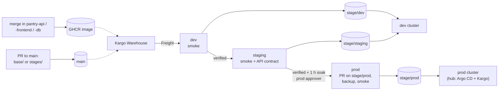
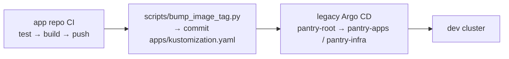

# pantry-gitops

GitOps repo for the [pantry-platform](https://github.com/pjvjay/pantry-platform)
demo. **Git is the only deployment mechanism.** Nobody runs `kubectl apply` against
the app. **Kargo** decides *which* verified release moves into *which* stage and
commits that to git. **Argo CD** makes each stage's cluster match what's committed.

> **Status:** the Kargo pipeline (epic milestones M0–M6) is in this repo.
> The live environment is still run by the legacy loop until the **dev cutover**
> ([runbook](docs/runbooks/cutover-dev.md)). See [Legacy loop](#legacy-loop-until-the-dev-cutover).

## How a change reaches prod



1. A new image in GHCR, or a merged change under `base/`/`stages/`, becomes **Freight**: three image
   digests plus one gitops commit.
2. **dev** auto-promotes it *(after cutover)*. Kargo clones `main` at the Freight's commit, pins digests,
   `kustomize build`s the stage, and commits the YAML to `stage/dev`. Argo CD syncs `pantry-infra-dev`,
   then `pantry-apps-dev` (the DB migration runs first as a PreSync hook). Then `pantry-smoke` verifies it.
3. A `Pantry.Promoter` promotes verified Freight to **staging**, which also runs the API contract checks.
4. After ≥ 1 h in staging, a `Pantry.ProdApprover` promotes to **prod**. Kargo opens a PR on `stage/prod`,
   and a prod approver merges it. The infra sync takes a **pre-promotion backup**, then the apps sync
   migrates and rolls.

Rollback = promote the previous Freight. Details: [rollback](docs/runbooks/rollback.md).
**Operating this platform (on-call, onboarding, procedures): [the delivery handbook](docs/runbooks/README.md).**

## Stages

| Stage | Cluster | Namespaces (app / db) | Verification | Entry gate |
|---|---|---|---|---|
| dev | dev *(stopped when idle)* | `pantry-app` / `pantry-db` *(the original env, adopted in place)* | smoke | auto *(after cutover)* |
| staging | dev | `pantry-staging-app` / `pantry-staging-db` | smoke + API contract | verified in dev; `Pantry.Promoter` |
| prod | prod *(also hosts the hub)* | `pantry-app` / `pantry-db` | smoke | verified in staging + 1 h soak; `Pantry.ProdApprover` + merged PR |

Prod additionally runs 3 Postgres instances with WAL archiving and backups to Azure Blob, 2 replicas per
workload with PDBs, and a backup before every promotion ([ADR 0008](docs/adr/0008-verification-and-gates.md)).

## Layout

| Path | What | Written by |
|---|---|---|
| `base/apps/`, `base/infra/{app-ns,db-ns}/` | shared manifests: no stage values, no image tags | humans (PR) |
| `base/components/stage-params/` | fans a stage's parameters out into the manifests | humans (PR) |
| `stages/<stage>/params/stage-params.yaml` | **the one file** of per-stage values: namespaces, host, Key Vault keys | humans (PR) |
| `stages/<stage>/{apps,infra}/` | render roots (+ prod hardening patches) | humans (PR) |
| `hub/bootstrap/root-app.yaml` | seed, applied once to the hub's Argo CD | humans |
| `hub/argocd/` | AppProject per stage + `pantry-delivery`, ApplicationSet, Kargo app | humans (PR) |
| `hub/kargo/` | Kargo Project, Warehouse, Stages, PromotionTasks, AnalysisTemplates, RBAC, credentials | humans (PR) |
| `hub/platform/` | Argo CD health checks that pantry-infra installs on the hub | humans (PR) |
| `stage/<stage>` **branches** | rendered, digest-pinned YAML that Argo CD syncs | **Kargo only** |
| `docs/adr/`, `docs/runbooks/`, `docs/handoffs/`, `docs/kargo-epic/` | decisions, operations, other repos' tasks, epic | humans |
| `argocd/`, `apps/`, `infra/`, `scripts/bump_image_tag.py` | **legacy**, live until cutover, deleted after (KARGO-25) | humans / app CI |

## Sync ordering (per stage)

Each promotion syncs **infra, then apps**. These are two Applications because a PreSync hook runs before
every sync wave, so merging them would deadlock a cold stage ([ADR 0004](docs/adr/0004-migration-compatibility.md)).

| Application | Wave / phase | Resource |
|---|---|---|
| `pantry-infra-<stage>` | -15 | Namespaces (`Prune=false,Delete=false`) |
| | -10 | ExternalSecrets |
| | -5 | CNPG `Cluster` (`Prune=false,Delete=false`) |
| | -4 (Sync hook, **prod only**) | `Backup/pantry-pre-promotion`: must complete, or the promotion stops |
| `pantry-apps-<stage>` | PreSync hook | `pantry-db-migrate` Job: schema migrated **before** workloads roll |
| | 0 | Deployments, Services, Ingresses (+ prod PDBs) |

## Secrets

No secret values exist in this repo, only *references*. Values live in the Key Vault of the stage's
cluster and are projected by External Secrets Operator + Workload Identity:

| Key Vault entry (per stage, from `stages/<stage>/params`) | → K8s Secret | Namespaces |
|---|---|---|
| `kvDbPasswordKey` (dev/prod: `pantry-db-password`, staging: `pantry-staging-db-password`) | `pantry-app-credentials` | db + app |
| `anthropic-api-key` (one key for all stages) | `anthropic-credentials` | app |
| `kvMcpTokensKey` (dev/prod: `pantry-mcp-tokens`, staging: `pantry-staging-mcp-tokens`) | `pantry-mcp-credentials` | app |
| `kargo-github-app-*` (hub Key Vault) | `kargo-git-pantry-gitops` (Kargo's git credential) | `pantry` (hub) |

Rotate in Key Vault; ESO re-syncs within 1 h (or force with an annotation). The entries are created by
[pantry-infra](https://github.com/pjvjay/pantry-infra)'s Terraform ([handoff](docs/handoffs/pantry-infra.md) §4).

**MCP tokens:** `pantry-mcp-tokens` holds bearer tokens for the API's `/mcp` endpoint as
`label:secret[,label:secret]`.
- The API reads them as `MCP_AUTH_TOKENS` with `optional: true`, so the Deployment still rolls without the
  entry (anonymous `/mcp`, submission tools disabled).
- The `pantry-mcp-credentials` ExternalSecret reports Degraded until the entry exists, and that holds the
  stage's infra sync, so create the entries first.
- `MCP_AUTH_TOKENS` is an environment variable, so a rotated value only takes effect after
  `kubectl rollout restart deployment/pantry-api -n <app namespace>`.
- To point an MCP client at a stage, pick ONE entry by label and pass its secret as
  `--header "Authorization: Bearer <secret>"` to `claude mcp add`:

```bash
az keyvault secret show --vault-name <kv> --name <kvMcpTokensKey> \
  --query value -o tsv | tr ',' '\n' | awk -F: '$1=="terraform"{print $2}'
```

## Operations

| | |
|---|---|
| Deploy a new API version | You don't. Merge in pantry-api; Kargo picks the image up, then [promote](docs/runbooks/promotion.md) |
| Promote / roll back | [promotion](docs/runbooks/promotion.md), [rollback](docs/runbooks/rollback.md) |
| Something failed | [troubleshooting](docs/runbooks/troubleshooting.md) |
| On call / new to the team | [on-call handbook](docs/runbooks/oncall.md), [onboarding](docs/runbooks/onboarding.md) |
| Add a schema migration | Numbered SQL file in pantry-db, **expand/contract only** ([contract](docs/handoffs/pantry-db.md)). It runs as PreSync in every stage it's promoted to |
| Add a service / a stage, rotate credentials, upgrades | [routine tasks](docs/runbooks/routine-tasks.md) |
| Incident: Kargo down, emergency prod revert, restore prod data | [break-glass & DR](docs/runbooks/break-glass-and-dr.md) |

## Safety net (CI: `.github/workflows/validate.yaml`)

Run the same checks locally before pushing:
```bash
python3 -m unittest discover -s scripts      # needs kustomize + PyYAML (+ lupa for the Lua tests)
python3 scripts/check_gitops.py              # 11 cross-layer and safety checks
scripts/render_stages.sh /tmp/rendered       # exactly what each stage would get (minus digests)
```
`check_gitops.py` checks that stage params, Argo CD and Kargo agree, and that:
- stages on one cluster don't share namespaces or Key Vault keys;
- data can't be cascade-deleted;
- Kargo never edits Applications, and syncs infra before apps;
- prod is PR-gated, soaked, HA and backed up;
- only prod approvers can promote to prod;
- **the dev stage renders identically to the live legacy env** (so adopting it can't touch the database).

Each rule has a mutation test proving it fails when it should. CI then validates every rendered manifest
strictly with kubeconform, including Kargo's CRDs from the exact chart version the hub runs.

## Bootstrap

The hub is the prod cluster. Platform prerequisites there:
- Argo CD, Argo Rollouts, Kargo
- ingress-nginx, cert-manager (`ClusterIssuer letsencrypt-prod`)
- CloudNativePG, External Secrets (`ClusterSecretStore azure-key-vault`)

The dev cluster needs the same minus Argo CD, Rollouts and Kargo. The full list, in order, is in the
[pantry-infra handoff](docs/handoffs/pantry-infra.md). In short:
```bash
scripts/bootstrap_stage_branches.sh                                   # once: stage/dev|staging|prod
KARGO_APP_ID=<id> PROD_APPROVERS_TEAM_ID=<id> scripts/github_rulesets.sh
kubectl --context <hub> apply -f hub/bootstrap/root-app.yaml
kubectl --context <hub> -n argocd get applications                    # pantry-hub-root, pantry-kargo, pantry-{infra,apps}-<stage>
```
Set each stage's DNS name in `stages/<stage>/params/stage-params.yaml` **and** in its Stage's verification
`host` arg (`hub/kargo/stages.yaml`). CI fails if the two differ.

## Legacy loop (until the dev cutover)

Today the dev cluster's own Argo CD runs the original environment from `argocd/` → `apps/` + `infra/`:



- **Until the cutover:** a manifest change must be made in **both** `apps/`/`infra/` and `base/`. CI's
  legacy-equivalence check fails if they drift. Rolling dev back is `git revert` of the bump commit.
- **Meanwhile, the hub** manages staging and prod, and staging takes Freight straight from the Warehouse
  (an interim `direct: true` in `hub/kargo/stages.yaml`).
- **The cutover** runs [the cutover runbook](docs/runbooks/cutover-dev.md). `scripts/cutover.py` makes the
  two repo changes: adopt dev, then enable dev auto-promotion.
- **Two weeks later (KARGO-25)**, the legacy trees and this section are deleted.
