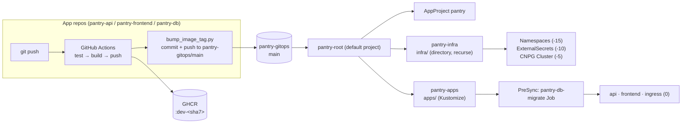

# 01 — Current-state analysis: `pantry-gitops` (baseline)

Scope: every file in this repository at the `baseline` commit (25 files).
The goal is to decide what has to change before Kargo can orchestrate promotions,
and what has to be kept as it is.

---

## 1. What the system does today

| Concern | Current implementation | Evidence |
|---|---|---|
| Deployment trigger | App-repo CI commits a new `newTag` to `main`. **That commit is the deployment.** | `apps/kustomization.yaml` L1-5, README "The loop" |
| Artifact versioning | Tags `dev-<sha7>`, mutable tag references (no digests) | `apps/kustomization.yaml` L15-23 |
| Environments | **One.** Namespaces `pantry-app` + `pantry-db`, one ingress host, one DB | `infra/namespaces.yaml`, `apps/**` |
| Argo CD topology | App-of-Apps: `pantry-root` (project `default`) → AppProject + 2 child Applications | `argocd/*.yaml` |
| Sync policy | All three Applications: `automated {prune, selfHeal}`; children also retry ×5 with backoff up to 3 m | `argocd/*-application.yaml` |
| Ordering | Sync waves -15/-10/-5/0 in infra. PreSync migration hook in apps. Cross-app ordering relies only on **retry** | `argocd/apps-application.yaml` L27-35 |
| DB migrations | `pantry-db-migrate` Job, PreSync hook, `BeforeHookCreation`. Forward-only; seed is idempotent | `apps/migrate-job.yaml` |
| Secrets | ESO → `ClusterSecretStore azure-key-vault`; no secret values in git | `infra/external-secrets/*` |
| Rollback | `git revert HEAD && git push` | README "Roll back" |
| Repo CI | **None** in this repo. `scripts/test_bump_image_tag.py` exists but nothing runs it | no `.github/` |
| Verification | Only K8s readiness/liveness probes (`/health`, `/healthz`). No post-deploy tests | `apps/*/deployment.yaml` |

### Things the baseline gets right (keep them)

1. **Git is the only way to deploy.** No `kubectl apply` against app resources. Kargo keeps this rule: it promotes by writing to git, not by touching the cluster.
2. **Secret hygiene.** The repo holds only references, and ESO + Workload Identity project the values. Kargo's own credentials should be delivered the same way (see story KARGO-08).
3. **Supply-chain awareness.** `bump_image_tag.py` exists to remove an unverified binary download from a job that holds deploy credentials. Kargo goes further: the CI jobs no longer need a deploy credential at all.
4. **Infra and apps are separate Applications.** This is **load-bearing**, not just style. See §3 R3.
5. **Careful in-file documentation.** Each manifest explains *why* it is the way it is. The new layout should keep this (see §3 R9 on tools that strip comments).

---

## 2. Gap analysis against a Kargo-based promotion model

Kargo needs these things from the repo it promotes through. Each row shows whether the baseline has it.

| Kargo needs… | Baseline | Gap |
|---|---|---|
| ≥2 **Stages** with isolated desired state | 1 environment; every manifest hard-codes `namespace: pantry-app` / `pantry-db` | **Blocking.** Per-stage namespaces, DB, hosts, secrets |
| A per-stage write target Kargo owns (path or branch) | One shared `images:` block in `apps/kustomization.yaml` | **Blocking.** Base + per-stage overlays and/or stage branches |
| Stage-specific parameters | Hard-coded `DB_HOST=pantry-rw.pantry-db.svc…` (api L39, migrate L35); ingress `pantry.example.com` ×3 ("CHANGE ME") | **Blocking.** Needs Kustomize patches/replacements |
| One Argo CD Application per Stage, annotated `kargo.akuity.io/authorized-stage` | 1 `pantry-apps` + 1 `pantry-infra`, not annotated | **Blocking.** ApplicationSet or per-stage Applications |
| An artifact Kargo can discover and order (Warehouse) | `dev-<sha7>` tags. Can't be ordered lexically or by SemVer. The `dev-` prefix would end up running in prod | **Major.** `NewestBuild` as a stop-gap, then a neutral tag scheme |
| Promotion of **config** changes, not just images | Edits to `apps/**` go live at once in the single env | **Major.** Without a git subscription, base changes skip the pipeline and hit every stage at once |
| Verification after promotion | None beyond probes | **Major.** AnalysisTemplates (Argo Rollouts CRDs) |
| Rollback = re-promote earlier Freight | `git revert` on `main` | Process + docs change. Also migration safety (R4) |
| Kargo has git write + registry read credentials | CI in 3 repos holds write creds for this repo | Move the credential into Kargo (ESO-projected) and **revoke** it from CI |
| Platform: Kargo, Argo Rollouts CRDs, cert-manager | cert-manager ✅ (`letsencrypt-prod`), Argo CD ✅, ingress-nginx ✅ | Add Kargo + Argo Rollouts to the platform contract |
| AppProject allows Kargo's resources | `clusterResourceWhitelist` = Namespace only. Kargo `Project` is **cluster-scoped** | New/extended AppProject |

---

## 3. Risks and findings

Ordered by severity. Each one is covered by a story in `03-epic-and-stories.md`.

### R1 — Restructuring can **delete the database** (Critical)
`pantry-apps` and `pantry-infra` carry `resources-finalizer.argocd.argoproj.io`, and `pantry-root` has `prune: true`.
Moving or renaming `argocd/apps-application.yaml` or `argocd/infra-application.yaml` in a PR would make the root app **prune the Application, and the finalizer would cascade-delete everything it manages**, including the CNPG `Cluster` `pantry` and its PVC.
**Mitigation:** a dedicated cutover runbook (KARGO-23). Take a CNPG backup first. Remove the finalizer (or delete non-cascading) *before* the file leaves git. The new stage Applications then adopt the live resources. Rehearse on kind first.

### R2 — Image tags carry an environment name and cannot be ordered (High)
`dev-073f1d7` gives no ordering. Kargo's `SemVer` and `Lexical` strategies can't use it, so only `NewestBuild` works, which has to fetch image metadata per tag (slower, and uses up the registry rate limit). Promoting a `dev-*` tag into staging and prod is confusing and undermines "build once, promote the same bytes".
**Mitigation:** Phase 1 uses `NewestBuild` + `allowTags: ^dev-[0-9a-f]{7}$` with no app-repo change. Phase 2 uses neutral, orderable tags (e.g. SemVer or `sha-<sha>` plus a build number), and promotion writes **digests** (KARGO-03, KARGO-24).

### R3 — PreSync hooks run before every sync wave (High, design constraint)
Argo CD runs `PreSync` hooks before *all* sync waves of an Application. If infra (namespace, ExternalSecrets, CNPG at waves -15…-5) and apps were merged into one Application per stage, the migration Job would wait for a database that is only created *after* PreSync finishes: a **deadlock on a cold stage**.
**Decision input:** keep **two Applications per stage** (`pantry-infra-<stage>`, `pantry-apps-<stage>`). A nice side effect: one Kargo promotion can run `argocd-update` for infra first and apps second. That gives the infra-before-apps ordering that today only comes from retry/backoff.

### R4 — Rollback is not symmetric with DB migrations (High)
Migrations only move forward. In Kargo, "rollback" means promoting older Freight. The older migrate image has fewer migrations, so it does nothing, and the older API runs against a **newer schema**. That works only if every migration is backward-compatible with the previous API release (expand/contract).
**Mitigation:** ADR-004 and a migration-compatibility contract for `pantry-db` (KARGO-04). Prod overlay takes a pre-promotion CNPG backup (KARGO-27).

### R5 — Interactions between Argo CD self-heal, ownership and Kargo (Medium)
- The root app self-heals the child `Application` objects. If Kargo ever changes an Application's spec (e.g. `argocd-update` with `updateTargetRevision: true`), **the root app or ApplicationSet will revert it.** Design rule: Kargo writes **git**, and `argocd-update` only triggers and checks a sync to a `desiredRevision`. It never edits the Application spec.
- `desiredRevision` is ambiguous if several stages share one branch. A promotion to staging adds commits that the dev Application also sees. Separate stage branches remove this ambiguity (ADR-002).
- ApplicationSet-owned Applications need a check that Kargo-triggered sync operations aren't clobbered (KARGO-05 spike).

### R6 — Config changes bypass any promotion gate (Medium)
With a single `main` + overlays layout, a change to a shared `base/` Deployment (env var, probe, resource limit) reaches **all stages in one commit**. A promotion pipeline that only promotes images leaves the change class that causes most outages ungated.
**Mitigation:** the Warehouse also subscribes to this repo's `main` (limited to `base/**`, `stages/**`). Freight = {api, frontend, migrate image, gitops commit}, rendered into per-stage branches (ADR-002).

### R7 — One database instance, no backups declared, one replica (Medium, prod readiness)
`postgres-cluster.yaml`: `instances: 1`, no `backup:` section. All Deployments have `replicas: 1` and no PDBs. That's fine for dev, but not for a stage called "prod".
**Mitigation:** prod overlay hardening (KARGO-27). This can be split into its own follow-up epic.

### R8 — Cluster is stopped when idle (Medium, operational)
README: "the dev cluster runs on demand (stopped when idle)". Kargo controllers stop with it. Warehouses catch up on start, but a promotion or AnalysisRun in flight when the cluster stops will fail. Hosting "prod" on a stop-when-idle cluster is a product decision, not a technical one (ADR-001).

### R9 — Tools that reformat YAML strip the explanatory comments (Low)
`bump_image_tag.py` is deliberately line-oriented to *keep* comments. Kargo's `kustomize-set-image` rewrites `kustomization.yaml` through kustomize's library, which does not keep comments. **Rule:** files Kargo writes (stage branches) are machine-owned and have no comments. Files humans read (`base/`, `stages/` on `main`) are never written by Kargo.

### R10 — Hygiene and drift found during the review (Low, cheap to fix)
| Finding | Location |
|---|---|
| Docs still describe `kustomize edit set image` in CI, which `bump_image_tag.py` replaced | README L15 (mermaid), `argocd/apps-application.yaml` L3-4, `apps/kustomization.yaml` L3-5 |
| Unit tests exist but no CI runs them; nothing validates `kustomize build` before merge | `scripts/`, no `.github/workflows` |
| `external-secrets.io/v1beta1` is deprecated in current ESO releases (`v1` is GA). Check against the installed ESO version | `infra/external-secrets/*.yaml` |
| Namespaces are owned twice: `infra/namespaces.yaml` **and** `CreateNamespace=true` on both child apps | `argocd/*-application.yaml` |
| Ingress host is still the placeholder `pantry.example.com` | `apps/pantry-ingress/*.yaml` |
| Root app lives in the `default` AppProject (documented choice, but it's the widest-scoped project) | `argocd/root-app.yaml` L22 |
| `pantry-mcp-credentials` being Degraded holds up the whole infra app when the KV entry is missing. This repeats per stage, so each stage's KV entries must exist first | `infra/external-secrets/mcp-creds.yaml` |

---

## 4. Cross-repo impact

This epic is **not contained in this repo**. Dependencies:

| Repo | Change | Stories |
|---|---|---|
| `pantry-gitops` (this) | Layout, ApplicationSet, Kargo resources, CI, docs | most |
| `pantry-infra` (Terraform) | Install Kargo + Argo Rollouts (platform contract). Per-stage Key Vault entries. DNS for per-stage hosts. GitHub App private key in KV. Entra ID app for Kargo SSO | KARGO-06/07/08/11 |
| `pantry-api`, `pantry-frontend`, `pantry-db` | **Remove** the gitops bump step and its write credential. Tag scheme. `pantry-api` publishes a test image for staging verification | KARGO-20/24 |
| GitHub org settings | GitHub App for Kargo. Branch protection on `main` and `stage/*` | KARGO-08/14 |

## 5. Open questions for the product owner

> **Answered.** See ADR 0001 and ADR 0007:
> 1. **No**, the data must persist. The existing namespaces are adopted in place as `dev`.
> 2. Prod runs on the **prod cluster**, which also hosts the Argo CD + Kargo hub.
> 3. Best practice chosen: **Entra ID OIDC with app roles**. `Pantry.ProdApprover` (a PIM-eligible
>    group) promotes to prod, and a PR merge on `stage/prod` by that team is the second gate.
> 4. **One** Anthropic key for all stages.

1. **Is the existing `pantry-db` data disposable?** If yes, all stages get fresh namespaces. If not, the existing namespaces are adopted in place as the `dev` stage (ADR-001 default).
2. **Where does "prod" run?** Phase 1 plan: namespaces per stage on the existing AKS cluster, with the stage→cluster mapping kept as data so a separate prod cluster later is a config change.
3. **Identity provider for Kargo UI/CLI:** Entra ID (assumed, given AKS + Key Vault)?
4. **Who approves prod?** A named Entra group for Kargo RBAC and GitHub PR review on `stage/prod`.
5. **Per-stage Anthropic keys?** Separate keys isolate spend and rate limits per stage, but cost more to manage.
