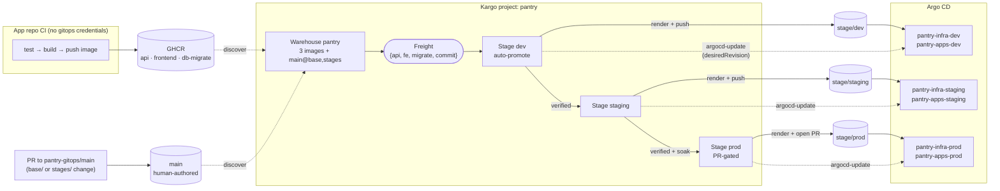

# 02 — Target architecture: Kargo-orchestrated promotion on Argo CD

> **Implemented through M6 (repo side), and the ADRs in [`docs/adr/`](../adr/) are authoritative.** Where this design
> doc differs, the ADRs win. Changes made after the product owner's answers:
> - **Prod runs on a separate prod cluster.** The control plane (Argo CD + Kargo, the "hub") runs there and
>   deploys to the dev cluster, which hosts dev + staging (ADR 0001). The §2 ADR-001 table below assumed
>   one cluster.
> - **Layout:** `hub/argocd/` + `hub/kargo/` (not `argocd/` + `kargo/`), because the legacy `argocd/` stays
>   live until the cutover. One AppProject **per stage**, plus `pantry-delivery`.
> - **Per-stage values:** one `stages/<stage>/params/stage-params.yaml` fanned out by
>   `base/components/stage-params`. `base/infra` is split into `app-ns/` and `db-ns/`.
> - **Data protection:** Namespaces and the CNPG `Cluster` carry `Prune=false,Delete=false`. That now
>   includes the live legacy ones.
> - **Identity:** Entra ID **app roles** (not group IDs) mapped to Kargo roles (ADR 0007).

> **Division of labour.** Argo CD stays the **sync engine**: it makes each stage's
> cluster state match git. Kargo becomes the **promotion engine**. It decides *which*
> validated artifacts and config move into *which* stage, writes that to git, asks
> Argo CD to sync that exact revision, and then verifies the result.
> Neither tool ever `kubectl apply`s workloads, so the "git is the only deployment
> mechanism" rule from the baseline still holds.

---

## 1. Target flow



### One promotion, step by step (any stage)

1. `git-clone` `main` **at the commit recorded in the Freight** into `./src`, and `stage/<stage>` into `./out`.
2. `git-clear` `./out`. Rendered output is always regenerated in full, never patched.
3. `kustomize-set-image` in `./src/stages/<stage>/apps`, pinning each image to the Freight's **digest**. This happens in the working copy only and is never committed to `main`.
4. `kustomize-build` `stages/<stage>/infra` → `./out/infra/`, and `stages/<stage>/apps` → `./out/apps/`.
5. `git-commit` and `git-push` to `stage/<stage>`. **prod:** push to a generated branch, then `git-open-pr` → `git-wait-for-pr`, so a human merge is the gate.
6. `argocd-update` `pantry-infra-<stage>` at `desiredRevision = <new commit>`, then `pantry-apps-<stage>`. The app sync still runs the **PreSync migration Job**. If the Job fails, the sync fails and the promotion fails.
7. Stage health comes from the Argo CD Applications. **Verification** then runs the AnalysisTemplates. Freight that passes is *verified in `<stage>`* and becomes eligible for the next stage.

---

## 2. Architecture Decision Records (proposed; ratified in Milestone 0)

### ADR-001 — Stage topology and environment isolation
**Decision (proposed):** three stages, `dev → staging → prod`, as **namespace pairs on the existing AKS cluster** for Phase 1:

| Stage | App ns | DB ns | Host | CNPG | Replicas |
|---|---|---|---|---|---|
| dev | `pantry-app` *(adopted in place)* | `pantry-db` *(adopted)* | `dev.pantry.<domain>` | 1 instance | 1 |
| staging | `pantry-staging-app` | `pantry-staging-db` | `staging.pantry.<domain>` | 1 instance | 1 |
| prod | `pantry-prod-app` | `pantry-prod-db` | `pantry.<domain>` | 3 instances + backups (KARGO-27) | 2 + PDB |

- **Per-stage hosts, not per-stage path prefixes.** The API's `--root-path=/pantry/api` and the SPA's `/pantry` base path are very likely baked into the frontend build. Changing paths per stage would mean building per stage, which breaks "build once, promote the same bytes".
- Keeping `dev` on the legacy namespace names avoids a data migration (answer to open question 1). Renaming can come later.
- The stage→cluster mapping lives in the ApplicationSet generator (`destination.name`). A dedicated prod cluster later is then a data change, not a redesign.

### ADR-002 — Git promotion pattern: **rendered stage branches**
| | A: overlays on `main`, Kargo commits to `main` | **B: rendered `stage/<stage>` branches (chosen)** |
|---|---|---|
| Config changes gated by the pipeline | ❌ `base/` edits hit every stage at once | ✅ `main` commit is part of the Freight |
| `desiredRevision` is unambiguous | ❌ other stages' commits move HEAD | ✅ only this stage's promotions touch its branch |
| Feedback loop if the Warehouse watches `main` | ❌ Kargo commits create new Freight | ✅ Kargo never writes `main` |
| Audit: "what exactly changed in prod?" | kustomization diff | ✅ fully rendered YAML diff = `git log stage/prod` |
| Prod gate | PR to `main` (mixed with everything else) | ✅ PR to `stage/prod` only |
| Branch protection | one branch for humans and bots | ✅ `main`: humans via PR. `stage/*`: Kargo GitHub App only |
| Comment preservation (R9) | ❌ Kargo rewrites human files | ✅ Kargo only writes machine-owned branches |
| Cost | simpler | more branches. Argo CD sources change from Kustomize to plain YAML |

### ADR-003 — Freight composition and artifact identity
- **One Warehouse, `pantry`**, with 4 subscriptions: `pantry-api`, `pantry-frontend`, `pantry-db-migrate` images, and the `pantry-gitops` git repo (`main`, `includePaths: base/, stages/`). Each Freight is one coherent release candidate, so "what is in prod" is a single Freight ID.
  *Alternative rejected for Phase 1:* one Warehouse per component. It allows independent cadence, but Stages must then request several Freight origins, and the API+migrate coupling becomes implicit.
- **Phase 1:** `imageSelectionStrategy: NewestBuild`, `allowTags: ^dev-[0-9a-f]{7}$`, `discoveryLimit: 10`. No app-repo change is needed.
- **Phase 2 (KARGO-24):** CI also pushes a neutral, orderable tag (e.g. SemVer `0.<run>.0` or `sha-<sha>`) and the Warehouse switches to `SemVer`/`Lexical`. Promotions always write **digests**.
- Freight is created automatically. A known race: a new API image can appear before the migrate image it needs. Dev verification catches this, and ADR-004 makes it harmless.

### ADR-004 — Database migrations under promotion and rollback
- The contract for `pantry-db`: **every migration must be backward-compatible with the previous API release** (expand → migrate → contract over ≥2 releases). It is enforced by review checklist and, in staging verification, by running the N-1 API smoke suite against the new schema (stretch).
- Rollback = promote earlier Freight. The app rolls back. **The schema does not.** Break-glass schema restore uses the CNPG backup taken before the prod promotion (KARGO-27).
- The migration keeps running as the PreSync hook inside `pantry-apps-<stage>`. Its success is part of the sync, and so part of the promotion.

### ADR-005 — Kargo ↔ Argo CD integration rules
1. Every Kargo-managed Application has `kargo.akuity.io/authorized-stage: pantry:<stage>`. Without it, Kargo must refuse to touch the Application. This is the security boundary between a Kargo Project and Argo CD.
2. **Kargo never edits Application specs** (no `updateTargetRevision`). Applications point at `stage/<stage>` permanently. `argocd-update` only triggers a sync and checks `desiredRevision`. This stops the root app and ApplicationSet from fighting Kargo (R5).
3. Argo CD **auto-sync and selfHeal stay on.** Drift is still reverted, and auto-sync only ever pulls what Kargo wrote to the stage branch.
4. Kargo, Argo CD and the workloads share one cluster for Phase 1. Kargo's controller reads Applications in namespace `argocd`. For multi-cluster later: Applications stay on the Argo CD control-plane cluster, which is the one Kargo talks to.
5. Kargo pipeline definitions (`kargo/`) are themselves GitOps-managed by a separate Argo CD Application and AppProject (`pantry-delivery`). The workload AppProject `pantry` stays least-privilege.

### ADR-006 — Platform installation location
Kargo and Argo Rollouts (CRDs, used for verification AnalysisTemplates) become part of the **platform contract** that `pantry-infra` satisfies, next to Argo CD, cert-manager, CNPG and ESO. This repo keeps consuming the contract rather than installing platform components. Chart versions are pinned and images pinned by digest (the same supply-chain stance as `bump_image_tag.py`).

---

## 3. Repository layout after the epic

```
main  (humans, via PR + CI)
├── argocd/
│   ├── root-app.yaml               unchanged seed
│   ├── project.yaml                AppProject pantry: + stage namespaces
│   ├── project-delivery.yaml       NEW AppProject pantry-delivery (Kargo CRs, ns pantry)
│   ├── pantry-stages-appset.yaml   NEW ApplicationSet → {infra,apps} × {dev,staging,prod}
│   └── kargo-application.yaml      NEW → kargo/
├── base/
│   ├── apps/                       today's apps/ minus stage-specific values
│   └── infra/
│       ├── app-ns/                 ExternalSecrets living in the app namespace
│       └── db-ns/                  CNPG Cluster + db ExternalSecret
├── stages/
│   ├── dev/{apps,infra}/kustomization.yaml
│   ├── staging/{apps,infra}/kustomization.yaml
│   └── prod/{apps,infra}/kustomization.yaml      HA patches, backups, PDBs
├── kargo/
│   ├── project.yaml  projectconfig.yaml  warehouse.yaml
│   ├── promotiontask-render.yaml  stages.yaml  analysis-templates.yaml
│   └── credentials-externalsecrets.yaml
├── scripts/                        bump_image_tag.py retired after cutover (KARGO-25)
└── docs/

stage/dev | stage/staging | stage/prod   (Kargo only — rendered, no comments)
├── infra/manifests.yaml
└── apps/manifests.yaml
```

`base/infra` is split into `app-ns/` and `db-ns/` because the resources span two namespaces. A Kustomize `namespace:` transformer can only set one namespace per kustomization.

---

## 4. Reference manifests (illustrative)

> ⚠️ **Version note.** Kargo's API is still `v1alpha1` and changes between minor releases
> (e.g. promotion policies moving from `Project` to `ProjectConfig`, `allowTags` →
> `allowTagsRegexes`, output-reference syntax inside `PromotionTask`s). These snippets show
> the **design**. They must be checked against the Kargo version pinned in KARGO-06, with a
> server-side dry-run as part of KARGO-13's CI. Treat field names as a starting point,
> not a contract.

### 4.1 Argo CD — stage Applications (ApplicationSet)
```yaml
apiVersion: argoproj.io/v1alpha1
kind: ApplicationSet
metadata:
  name: pantry-stages
  namespace: argocd
spec:
  goTemplate: true
  goTemplateOptions: ["missingkey=error"]
  generators:
    - matrix:
        generators:
          - list:
              elements:
                - {stage: dev,     cluster: in-cluster, appNs: pantry-app,         dbNs: pantry-db}
                - {stage: staging, cluster: in-cluster, appNs: pantry-staging-app, dbNs: pantry-staging-db}
                - {stage: prod,    cluster: in-cluster, appNs: pantry-prod-app,    dbNs: pantry-prod-db}
          - list:
              elements:
                - {layer: infra}
                - {layer: apps}
  template:
    metadata:
      name: 'pantry-{{.layer}}-{{.stage}}'
      annotations:
        # ADR-005 §1 — the ONLY Kargo Stage allowed to sync this Application.
        kargo.akuity.io/authorized-stage: 'pantry:{{.stage}}'
      # NOTE: deliberately no resources-finalizer — deleting an Application must never
      # cascade into a stage database (see analysis R1). Decide per stage in KARGO-12.
    spec:
      project: pantry
      source:
        repoURL: https://github.com/pjvjay/pantry-gitops.git
        targetRevision: 'stage/{{.stage}}'   # never edited by Kargo (ADR-005 §2)
        path: '{{.layer}}'
      destination:
        name: '{{.cluster}}'
        namespace: '{{ if eq .layer "infra" }}{{.dbNs}}{{ else }}{{.appNs}}{{ end }}'
      syncPolicy:
        automated: {prune: true, selfHeal: true}
        retry:
          limit: 5
          backoff: {duration: 10s, factor: 2, maxDuration: 3m}
```

### 4.2 Kargo — Project, Warehouse
```yaml
apiVersion: kargo.akuity.io/v1alpha1
kind: Project              # cluster-scoped; creates/claims namespace "pantry"
metadata:
  name: pantry
---
apiVersion: kargo.akuity.io/v1alpha1
kind: ProjectConfig        # Kargo >= 1.x; older releases: Project.spec.promotionPolicies
metadata:
  name: pantry
  namespace: pantry
spec:
  promotionPolicies:
    - stageSelector: {name: dev}
      autoPromotionEnabled: true
---
apiVersion: kargo.akuity.io/v1alpha1
kind: Warehouse
metadata:
  name: pantry
  namespace: pantry
spec:
  interval: 5m0s
  freightCreationPolicy: Automatic
  subscriptions:
    - image:
        repoURL: ghcr.io/pjvjay/pantry-api
        imageSelectionStrategy: NewestBuild      # Phase 1 (ADR-003)
        allowTags: ^dev-[0-9a-f]{7}$
        discoveryLimit: 10
    - image:
        repoURL: ghcr.io/pjvjay/pantry-frontend
        imageSelectionStrategy: NewestBuild
        allowTags: ^dev-[0-9a-f]{7}$
        discoveryLimit: 10
    - image:
        repoURL: ghcr.io/pjvjay/pantry-db-migrate
        imageSelectionStrategy: NewestBuild
        allowTags: ^dev-[0-9a-f]{7}$
        discoveryLimit: 10
    - git:
        repoURL: https://github.com/pjvjay/pantry-gitops.git
        branch: main
        commitSelectionStrategy: NewestFromBranch
        includePaths: [base/, stages/]           # kargo/, argocd/, docs/ changes ≠ new Freight
```

### 4.3 Kargo — reusable PromotionTask (render-to-stage-branch)
```yaml
apiVersion: kargo.akuity.io/v1alpha1
kind: PromotionTask
metadata:
  name: render-and-promote
  namespace: pantry
spec:
  vars:
    - name: gitopsRepo
      value: https://github.com/pjvjay/pantry-gitops.git
  steps:
    - uses: git-clone
      config:
        repoURL: ${{ vars.gitopsRepo }}
        checkout:
          - commit: ${{ commitFrom(vars.gitopsRepo).ID }}
            path: ./src
          - branch: stage/${{ ctx.stage }}
            create: true
            path: ./out
    - uses: git-clear
      config: {path: ./out}
    - uses: kustomize-set-image
      config:
        path: ./src/stages/${{ ctx.stage }}/apps
        images:
          - image: ghcr.io/pjvjay/pantry-api
            digest: ${{ imageFrom("ghcr.io/pjvjay/pantry-api").Digest }}
          - image: ghcr.io/pjvjay/pantry-frontend
            digest: ${{ imageFrom("ghcr.io/pjvjay/pantry-frontend").Digest }}
          - image: ghcr.io/pjvjay/pantry-db-migrate
            digest: ${{ imageFrom("ghcr.io/pjvjay/pantry-db-migrate").Digest }}
    - uses: kustomize-build
      config:
        path: ./src/stages/${{ ctx.stage }}/infra
        outPath: ./out/infra/manifests.yaml
    - uses: kustomize-build
      config:
        path: ./src/stages/${{ ctx.stage }}/apps
        outPath: ./out/apps/manifests.yaml
    - uses: git-commit
      as: commit
      config:
        path: ./out
        message: "promote ${{ ctx.targetFreight.name }} to ${{ ctx.stage }}"
    - uses: git-push
      config: {path: ./out}
    # Infra first, then apps: explicit cross-Application ordering (analysis R3).
    - uses: argocd-update
      config:
        apps:
          - name: pantry-infra-${{ ctx.stage }}
            sources:
              - repoURL: ${{ vars.gitopsRepo }}
                desiredRevision: ${{ task.outputs.commit.commit }}
    - uses: argocd-update
      config:
        apps:
          - name: pantry-apps-${{ ctx.stage }}
            sources:
              - repoURL: ${{ vars.gitopsRepo }}
                desiredRevision: ${{ task.outputs.commit.commit }}
```
*prod variant:* `git-push` with `generateTargetBranch: true`, then `git-open-pr` (target `stage/prod`) and `git-wait-for-pr`, and `argocd-update` on the merge commit.

### 4.4 Kargo — Stages and verification
```yaml
apiVersion: kargo.akuity.io/v1alpha1
kind: Stage
metadata:
  name: staging
  namespace: pantry
spec:
  requestedFreight:
    - origin: {kind: Warehouse, name: pantry}
      sources:
        stages: [dev]                # only Freight verified in dev
  promotionTemplate:
    spec:
      steps:
        - task: {name: render-and-promote}
  verification:
    analysisTemplates:
      - name: pantry-smoke
    args:
      - name: api-url
        value: http://pantry-api.pantry-staging-app.svc.cluster.local:8000
      - name: fe-url
        value: http://pantry-frontend.pantry-staging-app.svc.cluster.local
---
apiVersion: argoproj.io/v1alpha1
kind: AnalysisTemplate            # Argo Rollouts API, executed by Kargo
metadata:
  name: pantry-smoke
  namespace: pantry
spec:
  args:
    - name: api-url
    - name: fe-url
  metrics:
    - name: smoke
      provider:
        job:
          spec:
            backoffLimit: 1
            template:
              spec:
                restartPolicy: Never
                containers:
                  - name: smoke
                    image: curlimages/curl@sha256:<pinned>   # pin by digest
                    command: [sh, -ec]
                    args:
                      - |
                        curl -fsS --retry 10 --retry-delay 6 --retry-all-errors {{args.api-url}}/health
                        curl -fsS {{args.fe-url}}/healthz
```

### 4.5 Kargo credentials (ESO-projected, matching the baseline secret model)
```yaml
apiVersion: external-secrets.io/v1beta1      # align with installed ESO (analysis R10)
kind: ExternalSecret
metadata:
  name: kargo-git-pantry-gitops
  namespace: pantry
spec:
  refreshInterval: 1h
  secretStoreRef: {name: azure-key-vault, kind: ClusterSecretStore}
  target:
    name: kargo-git-pantry-gitops
    template:
      metadata:
        labels:
          kargo.akuity.io/cred-type: git
      data:
        repoURL: https://github.com/pjvjay/pantry-gitops.git
        githubAppID: "{{ .appId }}"
        githubAppInstallationID: "{{ .installationId }}"
        githubAppPrivateKey: "{{ .privateKey }}"
  data:
    - {secretKey: appId,          remoteRef: {key: kargo-github-app-id}}
    - {secretKey: installationId, remoteRef: {key: kargo-github-app-installation-id}}
    - {secretKey: privateKey,     remoteRef: {key: kargo-github-app-private-key}}
```

---

## 5. Security model (before → after)

| | Baseline | Target |
|---|---|---|
| Who can change what runs | Any of 3 app-repo CI jobs (write token to `main`) | Kargo GitHub App (writes `stage/*` only) + humans via PR to `main` |
| Prod gate | none | Kargo RBAC (promoter group) **and** PR review on `stage/prod` |
| Credential in CI | gitops write token ×3 | **none** (GHCR push only) |
| Artifact immutability | mutable tags | digests in rendered manifests |
| Audit trail | `git log main` (mixed) | Kargo Freight/Promotion history + `git log stage/<stage>` |

## 6. Rollback and break-glass

- **Normal rollback:** `kargo promote --project pantry --freight <previous> --stage <stage>` (or the UI). It is fully audited and goes through the same rendering path. Schema caveat: see ADR-004.
- **Kargo unavailable:** an admin with the break-glass role reverts the last commit on `stage/<stage>`. Argo CD converges as it does today. Document it and time-box it (KARGO-29).
