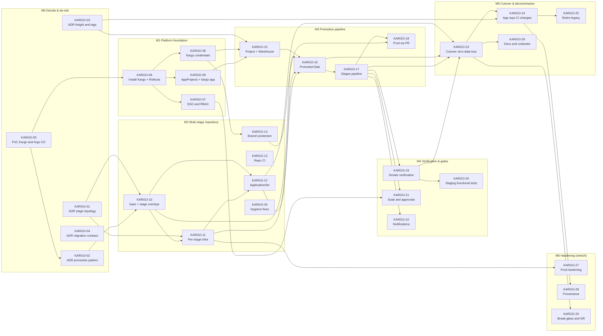

<!-- GENERATED by epic_backlog.py - edit the data there, not this file. -->
# 03 - Jira Epic: Progressive delivery for pantry-platform: Kargo-orchestrated promotion on Argo CD

## Epic

**Goal.** Replace the single-environment 'CI commits a tag to main' deployment loop with Kargo-orchestrated promotion of verified, immutable release candidates (Freight) through dev -> staging -> prod, with Argo CD remaining the sync engine for every stage.

**Business value**
- Changes (images AND manifest/config changes) reach prod only after passing dev and staging verification.
- Rollback becomes 'promote the previous Freight' instead of hand-reverting git commits on a shared branch.
- App-repo CI no longer holds write credentials to the deployment repo (removes 3 standing deploy credentials).
- Every stage's exact running state is auditable: Freight history in Kargo + rendered YAML in `stage/<stage>` branches.

**In scope**
- Multi-stage layout of this repo (base + stage overlays, per-stage infra, ApplicationSet).
- Kargo + Argo Rollouts CRDs added to the platform contract (installed by pantry-infra).
- Kargo Project, Warehouse, PromotionTask, Stages, verification, promotion policies, RBAC/SSO.
- Zero-data-loss cutover of the existing environment; removal of CI bump steps in app repos.

**Out of scope (follow-up epics)**
- Separate prod AKS cluster (design keeps it a config change; separate epic).
- Canary/blue-green rollouts of workloads via Argo Rollouts (only its AnalysisTemplate API is used).
- Observability stack (Prometheus/Grafana) - metric-based verification is a follow-up.

**Success metrics / epic acceptance**
- A commit to pantry-api reaches dev with no human action and prod with exactly one approval, with no direct git writes by CI.
- Lead time dev -> prod measured from Kargo Promotion timestamps; baseline captured in Sprint 1.
- Rollback of any stage to the previous Freight completes in < 10 min (game day in KARGO-29).
- Zero data loss during cutover (CNPG row counts identical before/after; backup verified).
- No gitops-repo write credential remains in pantry-api / pantry-frontend / pantry-db.

**Definition of Done (every story)**
- Manifests pass repo CI (kustomize build for all stages, kubeconform with CRD schemas, server-side dry-run where applicable).
- Any new behaviour documented in README/runbooks; comments explain *why*, matching repo convention.
- No secret values in git; all new credentials flow Key Vault -> ESO.
- Versions of all new third-party components pinned (chart version + image digest).

## Summary

- **30 issues**, **106 story points** total; **MVP (M0-M5) = 91 pts**, stretch (M6) = 15 pts.
- **MVP critical path (46 pts of sequential work):** KARGO-05 → KARGO-02 → KARGO-10 → KARGO-11 → KARGO-12 → KARGO-16 → KARGO-17 → KARGO-19 → KARGO-23 → KARGO-24 → KARGO-25
- Suggested cadence: 2-week sprints, ~2 engineers (~18-20 pts/sprint) → MVP in ~5-6 sprints.

| Milestone | Theme | Exit criteria | Issues | Pts | Status |
|---|---|---|---|---|---|
| M0 | Decide & de-risk | ADRs ratified, Kargo<->Argo CD behaviour proven on kind, Kargo version pinned. | KARGO-01, KARGO-02, KARGO-03, KARGO-04, KARGO-05 | 15 | Done / Done (repo) / Partial |
| M1 | Platform foundation | Kargo + Argo Rollouts CRDs running, SSO/RBAC, credentials, AppProjects. | KARGO-06, KARGO-07, KARGO-08, KARGO-09 | 13 | Done / Done (repo) + handoff / Handoff |
| M2 | Multi-stage repository | base/stages layout, per-stage infra, ApplicationSet, repo CI, branch protection. | KARGO-10, KARGO-11, KARGO-12, KARGO-13, KARGO-14, KARGO-30 | 19 | Done / Done (repo) + handoff / Partial / Scripted |
| M3 | Promotion pipeline | Warehouse -> dev -> staging -> prod promotions rendering to stage branches. | KARGO-15, KARGO-16, KARGO-17, KARGO-18 | 14 | Done (repo) |
| M4 | Verification & gates | Automated verification, soak/approval policies, notifications. | KARGO-19, KARGO-20, KARGO-21, KARGO-22 | 13 | Done (repo) / Done (repo) + handoff |
| M5 | Cutover & decommission | Existing env adopted without data loss, CI bump removed, docs rewritten. | KARGO-23, KARGO-24, KARGO-25, KARGO-26 | 17 | Done / Handoff / Ready (cutover + 2 weeks) / Ready to execute |
| M6 | Hardening (stretch) | Prod HA/backups, provenance, break-glass game day. | KARGO-27, KARGO-28, KARGO-29 | 15 | Done (docs) / Done (repo) + handoff / Done (repo), not enabled |

## Sprint plan

| Sprint | Focus | Issues (in order) | Pts |
|---|---|---|---|
| Sprint 1 | Decide & prove | KARGO-05, KARGO-01, KARGO-03, KARGO-04, KARGO-02, KARGO-13 | 18 |
| Sprint 2 | Platform + layout | KARGO-06, KARGO-08, KARGO-09, KARGO-10, KARGO-30 | 17 |
| Sprint 3 | Stages exist | KARGO-07, KARGO-11, KARGO-12, KARGO-14, KARGO-15 | 15 |
| Sprint 4 | First promotions | KARGO-16, KARGO-17, KARGO-19, KARGO-18 | 14 |
| Sprint 5 | Gates + cutover | KARGO-23, KARGO-21, KARGO-20, KARGO-22 | 18 |
| Sprint 6 | Decommission | KARGO-24, KARGO-26, KARGO-25, KARGO-29 | 11 |
| Sprint 7 | Stretch | KARGO-27, KARGO-28 | 13 |

Sprint 1 front-loads the PoC (KARGO-05) because it pins the Kargo version and validates the reference manifests everything else builds on. KARGO-13 (repo CI) has no dependencies and should land first so every later restructuring PR is validated. KARGO-25 needs two stable weeks after KARGO-24, so it may slip past Sprint 6.

## Dependency graph

## Stories

### M0 - Decide & de-risk

#### KARGO-01 · ADR-001: Stage topology & environment isolation
**Status: Done**: docs/adr/0001: dev adopted in place, staging on dev cluster, prod on prod cluster, hub on prod

`Spike` · **2 pts** · priority Highest · repo: pantry-gitops · labels: adr, architecture

**Why:** Kargo needs >= 2 isolated stages; the baseline has exactly one environment with namespaces, DB host and ingress host hard-coded. Topology drives every later story.

**Acceptance criteria**
- [ ] ADR merged under docs/adr/ deciding: stage list, namespace naming, host-per-stage vs path-per-stage, single cluster vs per-stage clusters, and per-stage vs shared Key Vault entries.
- [ ] Product owner answer recorded for 'is existing pantry-db data disposable?' and the dev adoption strategy derived from it.
- [ ] Resource budget for 3 stages estimated against current AKS node pool (incl. Kargo + Rollouts overhead).
- [ ] Explicit note on the stop-when-idle cluster and what that means for a stage named 'prod'.

*Depends on:* - · *Blocks:* KARGO-10, KARGO-11

#### KARGO-02 · ADR-002: Git promotion pattern (rendered stage branches vs overlays on main)
**Status: Done**: docs/adr/0002; promotion mechanics replayed offline against a bare repo

`Spike` · **3 pts** · priority Highest · repo: pantry-gitops · labels: adr, architecture

**Why:** Determines whether manifest/config changes are gated by the pipeline (analysis R6), whether argocd-update desiredRevision is unambiguous (R5), and whether Kargo ever rewrites human-authored, commented files (R9).

**Acceptance criteria**
- [ ] ADR compares both patterns on: config-change gating, revision ambiguity, Warehouse feedback loops, audit, prod gate, branch protection, comment preservation.
- [ ] Decision validated by the KARGO-05 PoC (not by documentation alone).
- [ ] Branch naming (`stage/<stage>`) and ownership rules (Kargo-only) recorded.

*Depends on:* KARGO-05 · *Blocks:* KARGO-10

#### KARGO-03 · ADR-003: Freight composition & artifact identity (tags, digests, Warehouse layout)
**Status: Done**: docs/adr/0003; GHCR inferred public (no imagePullSecrets)

`Spike` · **2 pts** · priority High · repo: pantry-gitops · labels: adr, supply-chain

**Why:** `dev-<sha7>` tags are not orderable (only NewestBuild works) and put an environment name on artifacts promoted to prod. Single vs multiple Warehouses changes how api+migrate coupling behaves.

**Acceptance criteria**
- [ ] Decision: one Warehouse `pantry` with 3 image + 1 git subscription (or documented alternative).
- [ ] Phase-1 selection strategy (NewestBuild + allowTags regex + discoveryLimit) and Phase-2 target tag scheme agreed with app-repo owners.
- [ ] Promotion writes image digests, not tags - confirmed.
- [ ] GHCR visibility confirmed (public/private) and registry rate-limit impact of polling interval assessed; webhook-triggered discovery evaluated.

*Depends on:* - · *Blocks:* KARGO-15, KARGO-24

#### KARGO-04 · ADR-004: DB migration compatibility contract under promotion & rollback
**Status: Done (repo)**: docs/adr/0004; contract text for pantry-db in docs/handoffs/pantry-db.md

`Spike` · **3 pts** · priority High · repo: pantry-db · labels: adr, database, cross-repo

**Why:** Rollback = promoting older Freight; migrations are forward-only, so the older API will run against a newer schema (analysis R4). Without a contract, rollback is unsafe.

**Acceptance criteria**
- [ ] Expand/contract rule documented in pantry-db CONTRIBUTING + PR template checklist.
- [ ] Behaviour of the PreSync migrate Job when older Freight is promoted is tested and documented (expected: no-op).
- [ ] Schema-restore break-glass path defined (links to KARGO-27 pre-promotion backup).

*Depends on:* - · *Blocks:* -

#### KARGO-05 · PoC: Kargo <-> Argo CD integration on kind (pin Kargo version)
**Status: Partial**: offline half done; 18-row live-cluster checklist in docs/kargo-epic/poc-kargo-argocd.md

`Spike` · **5 pts** · priority Highest · repo: pantry-gitops · labels: spike, argocd, kargo

**Why:** Several integration behaviours must be proven, not assumed: authorization annotation, argocd-update with desiredRevision under auto-sync/selfHeal, ApplicationSet ownership, PreSync hook failure propagation, and verification prerequisites. Output pins the Kargo version used everywhere else.

**Acceptance criteria**
- [ ] kind cluster with Argo CD, cert-manager, Argo Rollouts CRDs, Kargo (pinned chart) running a 2-stage copy of this repo.
- [ ] Proven: an Application WITHOUT `kargo.akuity.io/authorized-stage` is refused by argocd-update; WITH it, sync succeeds.
- [ ] Proven: auto-sync + selfHeal left ON does not conflict with argocd-update; root app/ApplicationSet do not revert Kargo-triggered syncs.
- [ ] Proven: failing PreSync migration Job -> failed sync -> failed Promotion -> Freight not verified.
- [ ] Proven: infra-then-apps argocd-update ordering on a cold stage converges without relying on retry.
- [ ] Reference manifests in docs/kargo-epic/02 corrected to the pinned version's schema; findings written up.

*Depends on:* - · *Blocks:* KARGO-02, KARGO-06

### M1 - Platform foundation

#### KARGO-06 · Add Kargo + Argo Rollouts CRDs to the platform contract (pantry-infra)
**Status: Handoff**: docs/handoffs/pantry-infra.md §1-2

`Story` · **5 pts** · priority High · repo: pantry-infra · labels: platform, kargo, cross-repo, supply-chain

**Why:** Kargo and the AnalysisTemplate API it uses for verification are new platform prerequisites, installed alongside Argo CD, cert-manager, CNPG and ESO (ADR-006).

**Acceptance criteria**
- [ ] Kargo Helm chart installed by pantry-infra Terraform at the version pinned in KARGO-05; images pinned by digest.
- [ ] Argo Rollouts CRDs (and controller if required by the pinned Kargo version) installed.
- [ ] Kargo uses existing cert-manager for webhook/API TLS; Kargo UI exposed via ingress-nginx with a letsencrypt-prod certificate.
- [ ] Kargo controller configured for Argo CD namespace `argocd`; controller restarts cleanly after `az aks stop/start`.
- [ ] Admin account disabled or its credential stored only in Key Vault; README 'Bootstrap' prerequisites list updated.

*Depends on:* KARGO-05 · *Blocks:* KARGO-07, KARGO-08, KARGO-09

#### KARGO-07 · Kargo SSO (Entra ID OIDC) and project RBAC
**Status: Done (repo) + handoff**: hub/kargo/rbac.yaml (Entra app roles); Entra + Helm values in handoff §5

`Story` · **3 pts** · priority Medium · repo: pantry-infra · labels: platform, security, rbac

**Why:** Promotion to prod must be restricted to an approver group; viewing should be broad.

**Acceptance criteria**
- [ ] Kargo API server authenticates via Entra ID OIDC.
- [ ] Groups mapped to Kargo roles: viewer (all), promoter (dev/staging), prod-approver (prod).
- [ ] A user outside prod-approver cannot promote to prod (tested).
- [ ] Group object IDs sourced from Terraform, not hard-coded in this repo.

*Depends on:* KARGO-06 · *Blocks:* KARGO-21

#### KARGO-08 · Kargo credentials: GitHub App (git write) + GHCR read, delivered via Key Vault -> ESO
**Status: Done (repo) + handoff**: hub/kargo/credentials.yaml; GitHub App + Key Vault in handoff §4, §6

`Story` · **3 pts** · priority High · repo: pantry-infra · labels: security, secrets, cross-repo

**Why:** Kargo becomes the only automated writer to the gitops repo. Its credential must follow the baseline secret model (no values in git) and be narrower than today's CI tokens.

**Acceptance criteria**
- [ ] GitHub App installed on pantry-gitops only, contents:write + pull_requests:write; private key stored in Key Vault by Terraform.
- [ ] ExternalSecret in Kargo project namespace produces a Secret labelled `kargo.akuity.io/cred-type: git`.
- [ ] If GHCR packages are private: read-only credential projected with `kargo.akuity.io/cred-type: image`.
- [ ] Rotation procedure documented (rotate in KV -> ESO refresh -> Kargo picks up).

*Depends on:* KARGO-06 · *Blocks:* KARGO-14, KARGO-15

#### KARGO-09 · AppProject `pantry-delivery` + Argo CD Application for kargo/; extend `pantry` destinations
**Status: Done**: hub/argocd/projects.yaml (per-stage + pantry-delivery), kargo-application.yaml

`Story` · **2 pts** · priority High · repo: pantry-gitops · labels: argocd, gitops

**Why:** Kargo `Project` is cluster-scoped and the `pantry` AppProject only whitelists Namespace. Keep workload project least-privilege and manage pipeline definitions via GitOps in their own project (ADR-005 #5).

**Acceptance criteria**
- [ ] New AppProject `pantry-delivery`: source = this repo, destination = ns `pantry`, cluster whitelist = kargo.akuity.io/Project only.
- [ ] New `argocd/kargo-application.yaml` syncs `kargo/` with sync-waves (Project before namespaced Kargo CRs).
- [ ] `pantry` AppProject destinations extended with staging/prod namespaces; nothing else widened.
- [ ] Root app picks both up with no manual kubectl.

*Depends on:* KARGO-06 · *Blocks:* KARGO-15

### M2 - Multi-stage repository

#### KARGO-10 · Restructure apps/ into base/apps + stages/<stage>/apps overlays
**Status: Done**: base/apps + stages/*/apps + base/components/stage-params; dev == legacy proven in CI

`Story` · **5 pts** · priority High · repo: pantry-gitops · labels: kustomize, gitops

**Why:** Stage-specific values are hard-coded today: `namespace: pantry-app`, DB_HOST `pantry-rw.pantry-db.svc...` (api + migrate Job), ingress host `pantry.example.com` (x3).

**Acceptance criteria**
- [ ] `base/apps` holds today's manifests with no stage-specific values; explanatory comments preserved.
- [ ] Overlays for dev/staging/prod set namespace, DB_HOST (via replacement/patch), ingress host + TLS secret, sizing.
- [ ] Equivalence check: rendered `stages/dev/apps` == rendered current `apps/` except intended differences (diff attached to PR).
- [ ] `apps/` left in place until cutover (KARGO-23) so the live env is untouched by this change.

*Depends on:* KARGO-01, KARGO-02 · *Blocks:* KARGO-11, KARGO-12, KARGO-16

#### KARGO-11 · Per-stage infra: namespaces, CNPG Cluster, ExternalSecrets, Key Vault entries, DNS
**Status: Done (repo) + handoff**: base/infra/{app-ns,db-ns} + stages/*/infra; Key Vault/DNS in handoff §4, §7

`Story` · **5 pts** · priority High · repo: pantry-gitops + pantry-infra · labels: infra, database, secrets, cross-repo

**Why:** Each stage needs its own DB and credentials. infra/ spans two namespaces, so it must be split (app-ns / db-ns) for Kustomize namespace transforms. Sync waves (-15/-10/-5) must survive.

**Acceptance criteria**
- [ ] `base/infra/{app-ns,db-ns}` + `stages/<stage>/infra` render the correct namespaces, KV keys and sync-wave annotations.
- [ ] pantry-infra Terraform creates per-stage KV entries (db password, mcp tokens; anthropic key per ADR-001) and DNS records.
- [ ] Missing-KV-entry failure mode (mcp-creds Degraded) documented per stage, with Terraform applied first.
- [ ] Staging stage infra comes up healthy from zero on the real cluster.

*Depends on:* KARGO-01, KARGO-10 · *Blocks:* KARGO-12, KARGO-16, KARGO-27

#### KARGO-12 · ApplicationSet generating pantry-{infra,apps}-<stage> Applications
**Status: Done**: hub/argocd/stages-appset.yaml; dev element enabled at cutover by design

`Story` · **3 pts** · priority High · repo: pantry-gitops · labels: argocd, applicationset

**Why:** Kargo requires one annotated Application per stage it promotes. Infra and apps MUST stay separate Applications: a PreSync hook runs before all waves, so merging them deadlocks a cold stage (analysis R3).

**Acceptance criteria**
- [ ] ApplicationSet (matrix: stage x layer) creates Applications targeting `stage/<stage>`, path `infra`|`apps`.
- [ ] Each carries `kargo.akuity.io/authorized-stage: pantry:<stage>`.
- [ ] Finalizer policy decided per stage and documented (no cascading delete into a stage DB).
- [ ] Staging + prod Applications live now; dev element added only during cutover (KARGO-23).
- [ ] `CreateNamespace=true` vs infra-owned Namespace double ownership resolved.

*Depends on:* KARGO-10, KARGO-11 · *Blocks:* KARGO-16, KARGO-23

#### KARGO-13 · CI for pantry-gitops: render, schema-validate and test every stage
**Status: Done**: .github/workflows/validate.yaml + scripts/check_gitops.py (23 mutation tests)

`Story` · **3 pts** · priority High · repo: pantry-gitops · labels: ci, quality, supply-chain

**Why:** There is no CI in this repo today; the existing unit tests are never run. With multiple stages, a broken overlay must fail in the PR, not in a promotion.

**Acceptance criteria**
- [ ] GitHub Actions workflow runs on PRs to main: `kustomize build` for every stages/*/*, kubeconform with CRD schemas (CNPG, ESO, Argo CD, Kargo, Rollouts), yamllint, `python3 -m unittest discover -s scripts`.
- [ ] Tooling binaries verified by checksum/digest pinned in the repo (consistent with bump_image_tag.py rationale); actions pinned by SHA.
- [ ] Kargo manifests validated against pinned CRDs (server-side dry-run on kind, or schema validation).
- [ ] Required status check on main.

*Depends on:* - · *Blocks:* -

#### KARGO-14 · Branch protection: main (PR + CI) and stage/* (Kargo GitHub App only)
**Status: Scripted**: scripts/github_rulesets.sh + bootstrap_stage_branches.sh; run by repo admin

`Task` · **1 pts** · priority Medium · repo: GitHub settings · labels: security, github

**Why:** Stage branches are machine-owned; humans editing them bypass Kargo's audit and verification.

**Acceptance criteria**
- [ ] main: PR required, KARGO-13 checks required, no direct pushes (incl. CI bots).
- [ ] stage/dev, stage/staging: push restricted to the Kargo GitHub App.
- [ ] stage/prod: changes only via PR with required review from prod-approver team; Kargo App may open PRs.
- [ ] Break-glass admin bypass documented (KARGO-29).

*Depends on:* KARGO-08 · *Blocks:* KARGO-18

#### KARGO-30 · Hygiene: ESO API version, documentation drift, placeholder host
**Status: Partial**: doc drift fixed, hosts centralised per stage; ESO v1 waits on cluster ESO versions

`Task` · **2 pts** · priority Low · repo: pantry-gitops · labels: tech-debt, docs

**Why:** Found during analysis (R10): docs still describe `kustomize edit set image`; ExternalSecrets use `external-secrets.io/v1beta1`; ingress host is a placeholder.

**Acceptance criteria**
- [ ] ExternalSecrets moved to the API version served by the installed ESO (v1 if available).
- [ ] README mermaid + comments in argocd/apps-application.yaml and apps/kustomization.yaml match reality.
- [ ] Placeholder host replaced by per-stage hosts from KARGO-10.

*Depends on:* - · *Blocks:* -

### M3 - Promotion pipeline

#### KARGO-15 · Kargo Project, ProjectConfig and Warehouse `pantry`
**Status: Done (repo)**: hub/kargo/project.yaml, warehouse.yaml

`Story` · **3 pts** · priority High · repo: pantry-gitops · labels: kargo, warehouse

**Why:** The Warehouse turns new images and config commits into Freight, the unit of promotion.

**Acceptance criteria**
- [ ] kargo/ contains Project, ProjectConfig and Warehouse per ADR-003; synced by the KARGO-09 Application.
- [ ] Git subscription limited to base/ and stages/ - a change in kargo/, argocd/ or docs/ creates NO Freight (tested).
- [ ] Pushing a new pantry-api image produces new Freight within the discovery interval (or webhook).
- [ ] Freight shows api, frontend, migrate digests + gitops commit in the UI.

*Depends on:* KARGO-03, KARGO-08, KARGO-09 · *Blocks:* KARGO-16

#### KARGO-16 · PromotionTask `render-and-promote` (render to stage/<stage>, argocd-update infra then apps)
**Status: Done (repo)**: hub/kargo/promotion-tasks.yaml: render-and-push / render-and-pr

`Story` · **5 pts** · priority High · repo: pantry-gitops · labels: kargo, promotion

**Why:** One reusable task implements the promotion for every stage, so stages can't drift in behaviour.

**Acceptance criteria**
- [ ] Task clones main at the Freight's commit, sets image digests, renders infra + apps, fully replaces stage branch contents.
- [ ] Commit message includes Freight ID and stage; rendered files contain digests (no tags).
- [ ] argocd-update runs infra first, then apps, each with desiredRevision = the new commit; no Application spec is modified.
- [ ] Re-promoting the same Freight is idempotent (no empty commits / or handled gracefully).
- [ ] Failure at any step leaves the stage branch and cluster in the previous good state.

*Depends on:* KARGO-15, KARGO-10, KARGO-11, KARGO-12 · *Blocks:* KARGO-17, KARGO-23

#### KARGO-17 · Stages dev -> staging -> prod with dev auto-promotion
**Status: Done (repo)**: hub/kargo/stages.yaml; dev auto-promotion flips on at cutover

`Story` · **3 pts** · priority High · repo: pantry-gitops · labels: kargo, promotion

**Why:** Defines the pipeline shape: only Freight verified upstream becomes eligible downstream.

**Acceptance criteria**
- [ ] Stage dev requests Freight directly from Warehouse; auto-promotion enabled via ProjectConfig.
- [ ] Stage staging sources from dev; prod sources from staging.
- [ ] Freight not verified in dev cannot be promoted to staging without explicit manual approval (tested).
- [ ] End-to-end: new api image -> dev automatically -> staging on one click, in the real cluster.

*Depends on:* KARGO-16 · *Blocks:* KARGO-18, KARGO-19, KARGO-21, KARGO-22, KARGO-23

#### KARGO-18 · Prod promotion via pull request on stage/prod
**Status: Done (repo)**: render-and-pr task + stage/prod rulesets

`Story` · **3 pts** · priority High · repo: pantry-gitops · labels: kargo, promotion, governance

**Why:** Two independent gates for prod: Kargo RBAC (who may promote) and GitHub review (what exactly changes, as a rendered YAML diff).

**Acceptance criteria**
- [ ] Prod promotion pushes to a generated branch, opens a PR to stage/prod, waits for merge (git-open-pr / git-wait-for-pr).
- [ ] argocd-update targets the merge commit.
- [ ] Closing the PR without merge fails the Promotion cleanly.
- [ ] PR description links the Freight and the source commits/images.

*Depends on:* KARGO-17, KARGO-14 · *Blocks:* -

### M4 - Verification & gates

#### KARGO-19 · Smoke-test AnalysisTemplate used by every stage
**Status: Done (repo)**: pantry-smoke on every stage via public hosts; script tested against local TLS servers

`Story` · **3 pts** · priority High · repo: pantry-gitops · labels: kargo, verification

**Why:** Today nothing runs after deploy apart from probes; 'verified' Freight must mean something.

**Acceptance criteria**
- [ ] AnalysisTemplate `pantry-smoke` (job, image pinned by digest) checks api /health, frontend /healthz, and ingress routing of /pantry and /pantry/api on the stage host.
- [ ] Configured as verification on dev, staging and prod with stage-specific args.
- [ ] A deliberately broken build fails verification in dev and is not eligible for staging (tested).

*Depends on:* KARGO-17 · *Blocks:* KARGO-20, KARGO-23

#### KARGO-20 · Staging functional verification using a test image published by pantry-api
**Status: Done (repo) + handoff**: black-box pantry-api-contract gates staging; deeper suite optional (handoffs/app-repos.md §4)

`Story` · **5 pts** · priority Medium · repo: pantry-gitops + pantry-api · labels: verification, cross-repo, testing

**Why:** Smoke tests prove liveness, not correctness. Staging should gate prod on API behaviour (recipes, MCP auth, /plan with LLM calls stubbed or budget-capped).

**Acceptance criteria**
- [ ] pantry-api CI publishes a versioned test-runner image alongside the app image (same commit).
- [ ] Staging AnalysisTemplate runs it against the staging host; results visible in the AnalysisRun.
- [ ] LLM-dependent tests are stubbed or budget-capped (Anthropic spend per run documented).
- [ ] Runtime < 10 min; flaky tests quarantined, not retried blindly.

*Depends on:* KARGO-19 · *Blocks:* -

#### KARGO-21 · Promotion policies: soak time, approvals, sync windows
**Status: Done (repo)**: prod requiredSoakTime 1h; auto-promotion only for dev; no sync windows (ADR 0008)

`Story` · **2 pts** · priority Medium · repo: pantry-gitops · labels: kargo, governance

**Why:** Prod eligibility should require time-in-staging, not just a green test run.

**Acceptance criteria**
- [ ] Freight must soak in staging for an agreed duration before prod eligibility (requiredSoakTime or equivalent for the pinned version).
- [ ] Auto-promotion disabled for staging and prod.
- [ ] If Argo CD sync windows are used for prod, their interaction with Kargo-triggered syncs is tested and documented.

*Depends on:* KARGO-17, KARGO-07 · *Blocks:* -

#### KARGO-22 · Promotion & verification notifications
**Status: Done (repo) + handoff**: Argo CD Notifications on every stage app; Kargo-event forwarding is a documented gap

`Story` · **3 pts** · priority Low · repo: pantry-gitops · labels: observability, notifications

**Why:** Humans need to know when Freight is ready for prod or a promotion failed.

**Acceptance criteria**
- [ ] Failed promotion/verification in any stage notifies the team channel.
- [ ] Freight verified in staging and eligible for prod notifies prod-approvers.
- [ ] Mechanism chosen (Kargo-native if available in pinned version, else Argo CD Notifications on stage Applications) and documented.

*Depends on:* KARGO-17 · *Blocks:* -

### M5 - Cutover & decommission

#### KARGO-23 · Cutover: adopt the live environment as stage dev with zero data loss
**Status: Ready to execute**: docs/runbooks/cutover-dev.md + scripts/cutover.py (every state tested); needs the live hub

`Story` · **8 pts** · priority Highest · repo: pantry-gitops · labels: cutover, database, runbook

**Why:** pantry-apps/pantry-infra carry resources-finalizer and the root app prunes: removing their files from git would cascade-delete the CNPG Cluster (analysis R1). This is the highest-risk change in the epic.

**Acceptance criteria**
- [ ] Runbook written and rehearsed end-to-end on kind with a seeded DB, including rollback steps.
- [ ] CNPG backup taken and restore-tested before the change.
- [ ] Finalizers removed / non-cascading deletion of pantry-apps and pantry-infra BEFORE their files leave git.
- [ ] pantry-{infra,apps}-dev adopt live resources; no pod restarts of the CNPG instance; row counts identical before/after.
- [ ] First Kargo promotion to dev succeeds; `kubectl get applications -n argocd` shows the new set, all Synced/Healthy.

*Depends on:* KARGO-12, KARGO-16, KARGO-17, KARGO-19 · *Blocks:* KARGO-24, KARGO-26, KARGO-29

#### KARGO-24 · App repos: remove gitops bump step, revoke write credentials, adopt neutral tags
**Status: Handoff**: docs/handoffs/app-repos.md §1-2; Warehouse SemVer switch specified

`Story` · **5 pts** · priority High · repo: pantry-api, pantry-frontend, pantry-db · labels: ci, security, cross-repo, supply-chain

**Why:** After cutover the bump commits to main would be ignored by Kargo but still confusing - and the credential is a standing risk. Phase 2 of ADR-003 tags images neutrally and orderably.

**Acceptance criteria**
- [ ] Bump step removed from all 3 workflows; gitops write credential deleted from each repo/org secret.
- [ ] Images additionally tagged per ADR-003 Phase 2; Warehouse switched to SemVer/Lexical; `dev-` prefix no longer required.
- [ ] Verified: no identity other than the Kargo GitHub App (and PR-merging humans) can write to pantry-gitops.

*Depends on:* KARGO-23, KARGO-03 · *Blocks:* KARGO-25, KARGO-28

#### KARGO-25 · Retire scripts/bump_image_tag.py and legacy apps/ + argocd child apps
**Status: Ready (cutover + 2 weeks)**: commands in cutover runbook step 9; post-retirement state tested

`Task` · **1 pts** · priority Low · repo: pantry-gitops · labels: tech-debt

**Why:** Superseded by Kargo's in-process kustomize-set-image. Keep for an agreed period as break-glass only.

**Acceptance criteria**
- [ ] Removed after 2 weeks of stable Kargo operation (or retained, documented as break-glass, if KARGO-29 needs it).
- [ ] Legacy apps/, argocd/apps-application.yaml, argocd/infra-application.yaml removed (their Applications already gone per KARGO-23).

*Depends on:* KARGO-24 · *Blocks:* -

#### KARGO-26 · Rewrite README + operator runbooks for the Kargo model
**Status: Done**: README rewritten; delivery handbook in docs/runbooks/ (onboarding, on-call, promotion, rollback, troubleshooting, routine tasks, reference)

`Story` · **3 pts** · priority High · repo: pantry-gitops · labels: docs, runbook

**Why:** README describes the old loop, rollback by `git revert HEAD`, and 'Deploy a new API version - you don't'.

**Acceptance criteria**
- [ ] README: new loop diagram, layout, sync ordering per stage, Kargo concepts (Warehouse/Freight/Stage) in one paragraph each.
- [ ] Runbooks: promote, roll back (promote previous Freight + schema caveat), add a service, add a stage, rotate Kargo credentials.
- [ ] 'Who can deploy what, how' table reflecting the new security model.

*Depends on:* KARGO-23 · *Blocks:* -

### M6 - Hardening (stretch)

#### KARGO-27 · Prod stage hardening: CNPG HA + backups, pre-promotion backup, replicas, PDBs
**Status: Done (repo) + handoff**: prod HA/backups/PDBs + pre-promotion backup hook; storage, identity, health Lua in handoff §11

`Story` · **8 pts** · priority Medium · repo: pantry-gitops + pantry-infra · labels: prod-readiness, database, ha

**Why:** Baseline runs 1 Postgres instance with no backup config and 1 replica per Deployment (analysis R7); rollback of a schema requires a backup taken before the prod migration (ADR-004).

**Acceptance criteria**
- [ ] Prod overlay: CNPG instances=3, barman backups to Azure Blob (storage + identity via pantry-infra), restore tested.
- [ ] A CNPG Backup is taken before each prod promotion's migration (PreSync hook in prod overlay or promotion step) and its success gates the sync.
- [ ] Prod Deployments: replicas >= 2, PodDisruptionBudgets, anti-affinity.

*Depends on:* KARGO-11 · *Blocks:* -

#### KARGO-28 · Artifact provenance: sign images in CI and verify before promotion
**Status: Done (repo), not enabled**: pantry-provenance + no-bypass rule; enable after app repos sign (handoffs/app-repos.md §3)

`Story` · **5 pts** · priority Low · repo: all app repos + pantry-gitops · labels: supply-chain, security

**Why:** Digests make artifacts immutable; signatures prove where they came from.

**Acceptance criteria**
- [ ] CI signs images (cosign keyless / GitHub OIDC) and attaches SBOM attestations.
- [ ] Verification step (AnalysisTemplate job or admission policy) rejects unsigned images before staging.
- [ ] Approach documented against Kargo's native capabilities in the pinned version.

*Depends on:* KARGO-24 · *Blocks:* -

#### KARGO-29 · Break-glass & DR procedures + rollback game day
**Status: Done (docs)**: docs/runbooks/break-glass-and-dr.md incl. game day; first game day pending

`Story` · **2 pts** · priority Medium · repo: pantry-gitops · labels: runbook, dr

**Why:** Kargo becomes a critical path; the team must be able to deploy/roll back when it is down.

**Acceptance criteria**
- [ ] Break-glass: revert on stage/<stage> by admin bypass, documented + audited; Kargo reconciles afterwards.
- [ ] Game day executed: roll prod back one Freight in < 10 min; Kargo-down scenario exercised.
- [ ] Recovery of Kargo state documented (pipeline in git, history in stage branches).

*Depends on:* KARGO-23 · *Blocks:* -

## Risk register (epic level)

| # | Risk | L | I | Mitigation | Owner story |
|---|---|---|---|---|---|
| 1 | Cascade deletion of CNPG cluster during restructure (finalizer + prune) | M | Critical | Runbook, backup, finalizer removal before git change, kind rehearsal | KARGO-23 |
| 2 | Kargo v1alpha1 API churn between minor versions | H | M | Pin version in PoC; CI validates against pinned CRDs; upgrade as explicit story | KARGO-05/13 |
| 3 | Rollback runs old API on new schema | M | H | Expand/contract contract, pre-prod backup | KARGO-04/27 |
| 4 | Kargo/Argo CD fight over Application state | L | H | Kargo never edits Application spec; proven in PoC | KARGO-05/12 |
| 5 | Cross-repo changes (pantry-infra, app repos) stall the epic | M | M | Cross-repo stories labelled; owners named at kickoff; Phase-1 needs no app-repo change | KARGO-06/08/11/24 |
| 6 | Cluster stop/start interrupts promotions & AnalysisRuns | M | L | Documented; promotions are re-runnable; prod hosting decision in ADR-001 | KARGO-01 |
| 7 | 3x workloads exceed the small AKS node pool | M | M | Budget in ADR-001; small staging sizing | KARGO-01 |
| 8 | Registry polling rate limits with NewestBuild | M | L | discoveryLimit, interval, webhook receiver; Phase-2 orderable tags | KARGO-03/24 |
