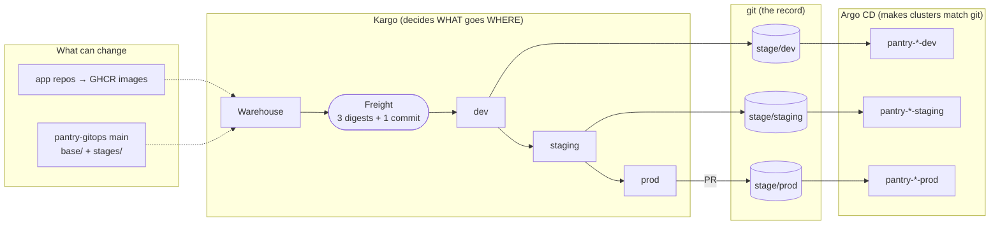

# Onboarding: your first two weeks on the pantry delivery platform

By the end of this you will be able to explain how a commit reaches prod, promote to staging, review a
prod promotion, roll a stage back, and join the on-call rotation. Work through it with a **buddy** who is
already on the rotation.

## 1. The platform in one picture



**Three layers, three jobs:**

| Layer | Job | Source of truth |
|---|---|---|
| `main` branch | what we *intend* (manifests, per-stage params, the pipeline itself) | PRs, reviewed, CI-validated |
| Kargo | *which* verified Freight goes into *which* stage, and when | Freight + Stage status (UI) |
| `stage/<stage>` branches + Argo CD | what actually *runs*: rendered, digest-pinned YAML that Argo CD syncs | `git log origin/stage/<stage>` |

**Two clusters:**
- The **dev cluster** (stopped when idle) runs `dev` and `staging`.
- The **prod cluster** runs `prod` *and* the hub (Argo CD + Kargo).

That's why verification checks run against public hostnames: the hub can't reach inside the dev cluster.

## 2. The golden rules

1. **Git is the only deployment mechanism.** Never `kubectl apply/edit/delete` app resources. Argo CD
   self-heals and reverts you, and you will have broken the audit trail.
2. **Never push to `stage/*` branches.** Kargo owns them. The only exception is break-glass, with an
   incident ticket.
3. **Never "fix" a stage by editing `main`.** `main` changes become Freight and travel dev → staging → prod.
   To change what a stage runs, *promote*.
4. **Rollback = promote the previous Freight.** Not `git revert`, not `kubectl rollout undo`.
5. **Always pass `--context`.** `pantry-app` exists on both clusters (dev on `dev`, **prod on `hub`**).
6. **Migrations are expand/contract.** Rolling back never rolls back the schema.
7. **Pipeline changes are PRs too.** `hub/kargo/` and `hub/argocd/` are GitOps-managed; hand edits in the
   Kargo UI are reverted.
8. **Never remove** `kargo.akuity.io/authorized-stage` or `Prune=false,Delete=false` annotations. They are
   the security boundary and the data-loss guard.
9. **When CI's `check_gitops.py` fails, fix the cause, not the check.** Every rule names the ADR it protects.
10. **Break-glass is logged.** Every bypass gets an incident ticket and a follow-up promotion to re-align Kargo.

## 3. Day 1: access and tools

### Access (ask your lead; tick when it works)
- [ ] Entra group `pantry-delivery-viewers` (role `Pantry.Viewer`): Kargo UI, read-only
- [ ] GitHub org membership with write access to `pantry-gitops` (PRs to `main`)
- [ ] Azure RBAC: read access to both AKS clusters (for `kubectl get/logs/describe`)
- [ ] Argo CD SSO login (read-only for humans on prod)
- [ ] *After §6 sign-off:* `pantry-delivery-promoters` (`Pantry.Promoter`)
- [ ] *When you join the rotation:* PIM-eligible for `pantry-oncall` and `pantry-prod-approvers`, plus
      GitHub team `pantry-prod-approvers`

### Tools
| Tool | Why |
|---|---|
| `az`, `kubectl`, `kubelogin` | cluster access |
| `kargo` CLI: **same version as the server** (the Kargo UI's CLI download, or the matching GitHub release) | promotions from the terminal |
| `argocd` CLI | Application status, history, diff |
| `gh` | prod promotion PRs |
| `kustomize` v5, `python3` + `pyyaml` (+ `lupa`) | run CI's checks locally |
| `kubectl cnpg` plugin | Postgres status |

### Contexts and logins
Commands are in [reference.md §4](reference.md#4-command-cheat-sheet) ("Log in / set up"). Then confirm:
```bash
kubectl --context dev -n pantry-app get deploy          # dev workloads (dev cluster must be running)
kubectl --context hub -n pantry get stages              # Kargo stages: dev, staging, prod
kargo get stages                                        # same via the CLI
```
Put the kube context in your shell prompt **today**.

## 4. Day 2–3: read, in this order

| Read | You'll understand |
|---|---|
| [ADR 0001](../adr/0001-stage-topology.md) | why stages sit where they do; hub on prod |
| [ADR 0002](../adr/0002-rendered-stage-branches.md) | why Kargo renders into `stage/*` branches |
| [ADR 0005](../adr/0005-kargo-argocd-integration.md) | the Kargo ↔ Argo CD rules |
| [ADR 0007](../adr/0007-identity-and-approvals.md) | who may do what; the two prod gates |
| [ADR 0008](../adr/0008-verification-and-gates.md) | what "verified" means per stage |
| `hub/kargo/stages.yaml`, `hub/kargo/promotion-tasks.yaml` | the pipeline, step by step |
| `stages/staging/params/stage-params.yaml` | how one file parameterises a stage |
| [promotion.md](promotion.md), [rollback.md](rollback.md) | the two procedures you'll run most |

## 5. Your local loop

```bash
python3 -m unittest discover -s scripts      # all tests, incl. "mutation" tests that break rules on purpose
python3 scripts/check_gitops.py              # the 11 cross-layer safety checks CI runs
scripts/render_stages.sh /tmp/rendered       # exactly what each stage would get (minus digests)
diff /tmp/rendered/staging-apps.yaml /tmp/rendered/prod-apps.yaml   # see how stages differ
```

## 6. Exercises (with your buddy) → sign-off

| # | Exercise | Done when you can… |
|---|---|---|
| E1 | **Trace prod.** Find prod's current Freight in the Kargo UI. Map each image tag `dev-<sha>` to its app-repo commit, and find the `stage/prod` commit that deployed it (`git log origin/stage/prod`; the Freight name is in the message) | explain what runs in prod, down to commits |
| E2 | **Break a rule locally.** Remove `Prune=false,Delete=false` from `base/infra/db-ns/namespace.yaml` and run `check_gitops.py`. Then change `stages/staging/params` to reuse `pantry-app` | explain both failures and why they matter (R1, ADR 0001) |
| E3 | **Ship a harmless config change.** PR a label or comment-level change under `base/`; watch CI, then the new Freight appear, then dev (auto) | find your change in `git show origin/stage/dev` |
| E4 | **Promote staging** (buddy holds `Pantry.Promoter`, you drive): follow [promotion.md §3](promotion.md#3-promote-to-staging) | read the AnalysisRun results yourself |
| E5 | **Shadow a prod promotion.** Review the PR diff with the checklist in [promotion.md §4](promotion.md#4-promote-to-prod) | say what the diff changes and whether it's safe |
| E6 | **Roll back staging** to the previous Freight ([rollback.md §5](rollback.md#5-procedure-b-roll-back-staging)) | do it without notes |
| E7 | **Read a failure.** Your buddy picks a past failed Promotion or AnalysisRun; find the cause with [troubleshooting.md](troubleshooting.md) | name the failing step and its fix in < 10 min |
| E8 | **Read** [break-glass-and-dr.md](break-glass-and-dr.md) and take part in one game day | describe BG-1 and DR-2 from memory |

**Sign-off for `Pantry.Promoter`:** E1–E4 done. **Sign-off for the on-call rotation:** all of E1–E8,
plus one shadow on-call week. Your lead records it in the team tracker.

## 7. Where to ask
- **Team channel:** the same Teams channel that receives the Argo CD notifications.
- **Pipeline or platform:** the platform team (see [oncall.md §7](oncall.md#7-escalation)).
- **App behaviour:** the owning app repo's maintainers.
