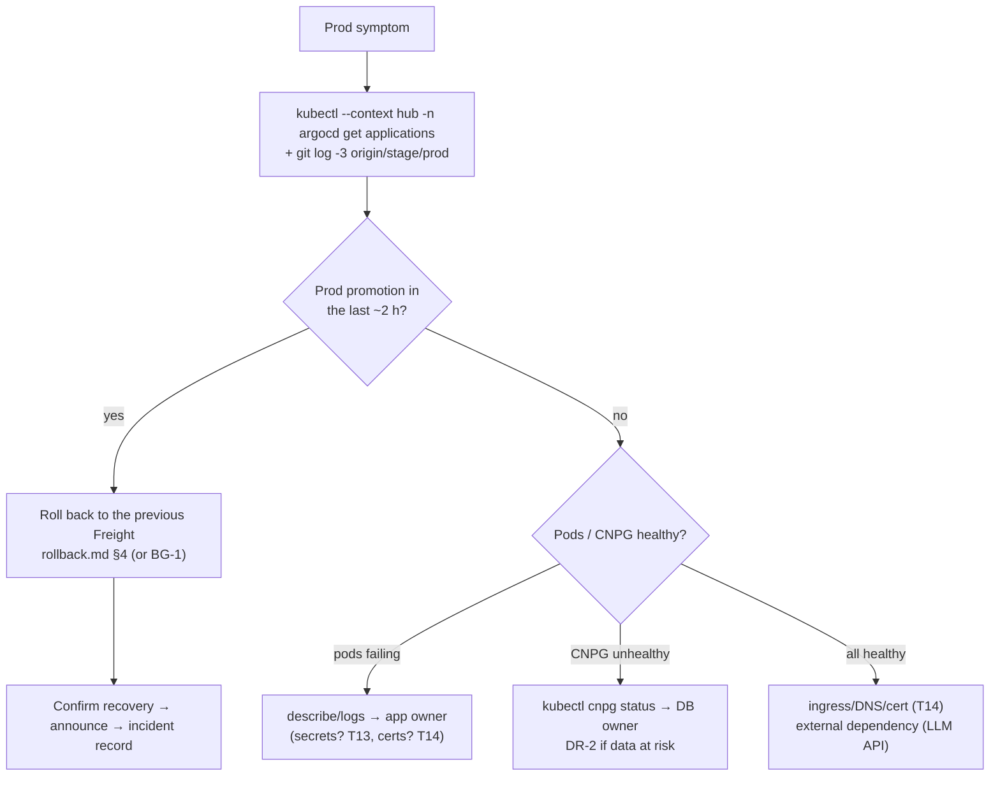

# On-call handbook: pantry delivery platform

## 1. What on-call owns
| You own | You don't own (but you triage and route) |
|---|---|
| The pipeline: Warehouse, Promotions, verification, stage Applications | Application bugs (pantry-api/-frontend/-db maintainers) |
| First response to alerts for any stage | Cluster/platform components (pantry-infra / platform team) |
| Prod rollbacks, and helping with promotions | Azure outages (Azure support) |
| Keeping Kargo's view of the stages true after any break-glass | |

**Your roles on shift:** `Pantry.Oncall` (PIM, activate at shift start), `Pantry.Promoter`, and
`Pantry.ProdApprover` (PIM, activate when you need it). Also GitHub team `pantry-prod-approvers`.

## 2. Shift start (15 min)
Activate `Pantry.Oncall` in PIM, read the handover note (§10), then:

| # | Check | Command / place | Good |
|---|---|---|---|
| 1 | Argo CD | `kubectl --context hub -n argocd get applications` | all `Synced`/`Healthy`. dev/staging may be `Unknown` if the dev cluster is stopped |
| 2 | Stages | Kargo UI, or `kubectl --context hub -n pantry get stages` | each stage healthy, current Freight known |
| 3 | Promotions | `kubectl --context hub -n pantry get promotions --sort-by=.metadata.creationTimestamp \| tail` | none `Running` longer than normal ([reference §3](reference.md#3-timings-what-normal-looks-like)); every `Errored` one explained in the handover |
| 4 | Prod PRs waiting | `gh pr list -R pjvjay/pantry-gitops --base stage/prod` | none forgotten (each is a Promotion waiting) |
| 5 | Warehouse | `kubectl --context hub -n pantry describe warehouse pantry` | no discovery errors; recent Freight exists if there were builds |
| 6 | Prod backups | `kubectl --context hub -n pantry-db get backups --sort-by=.metadata.creationTimestamp \| tail -3` | last `pantry-daily` **completed** < 26 h ago |
| 7 | WAL archiving | `kubectl cnpg status pantry -n pantry-db --context hub` | continuous archiving working |
| 8 | Secrets | `kubectl --context hub -n pantry-app get externalsecret` (repeat per stage) | all `SecretSynced` |
| 9 | Certs | `kubectl --context hub -n pantry-app get certificate` | `Ready=True`; cert-manager renews ~30 days before expiry |
| 10 | Kargo / Argo CD pods | `kubectl --context hub -n kargo get pods`; `… -n argocd get pods` | all Running, few restarts |

Anything red: fix it now, or write it in the handover with an owner.

## 3. Alerts and what to do

| Alert / signal | Severity | First action | Runbook |
|---|---|---|---|
| Teams: **sync failed**, prod app | SEV2 (SEV1 if users affected) | Is a promotion running? If yes, it will fail and prod keeps the old version. If no, it's drift or a cluster problem | [T7](troubleshooting.md#t7-promotion-fails-at-argocd-update-infra), [T9](troubleshooting.md#t9-promotion-fails-at-argocd-update-apps), [T12](troubleshooting.md#t12-application-outofsync-or-drifting) |
| Teams: **health degraded**, prod app | SEV1 if users affected | Right after a prod promotion? **Roll back.** Otherwise triage pods / CNPG | [rollback.md](rollback.md), [T3](troubleshooting.md#t3-stage-or-application-unknown--unhealthy-without-a-promotion) |
| Teams: sync failed / degraded, dev or staging | SEV3 | Usually a bad Freight. Stop it progressing (quarantine), tell the author | [T9](troubleshooting.md#t9-promotion-fails-at-argocd-update-apps), [rollback.md §7](rollback.md#7-quarantine-the-bad-freight) |
| Teams: **deployed** | info | none; it's the audit trail | n/a |
| Promotion `Errored` (Kargo UI / event forwarder) | SEV3 (SEV2 for prod) | Find the failing step | [troubleshooting.md](troubleshooting.md) |
| Verification failed in staging | SEV3 | Real regression or environment? Don't promote that Freight to prod | [T10](troubleshooting.md#t10-verification-fails) |
| Prod pre-promotion backup failed | SEV2 | The prod promotion is blocked (correctly). Fix backups | [T8](troubleshooting.md#t8-prod-pre-promotion-backup-fails) |
| Daily backup missing / WAL archiving failing | SEV2 | Prod has no fresh restore point | [T8](troubleshooting.md#t8-prod-pre-promotion-backup-fails) |
| Kargo down | SEV3 (SEV2 if a prod fix is waiting) | Platform team | [T15](troubleshooting.md#t15-kargo-or-the-hub-argo-cd-is-unhealthy) |
| Hub Argo CD down | SEV2 | Platform team; nothing self-heals anywhere | [T15](troubleshooting.md#t15-kargo-or-the-hub-argo-cd-is-unhealthy) |
| User report: prod broken | SEV1/2 | Check the last prod promotion time vs when the symptom started | [rollback.md §2](rollback.md#2-decide-roll-back-roll-forward-or-restore) |

## 4. Severities

| Sev | Definition | Respond | Update cadence |
|---|---|---|---|
| SEV1 | Prod down or data at risk | immediately; open an incident; page the secondary | every 30 min |
| SEV2 | Prod degraded; prod release or backups blocked | within 30 min | hourly |
| SEV3 | dev/staging broken; pipeline impaired, no prod impact | same working day | daily |

## 5. Triage: the first 10 minutes of a prod incident



## 6. Do and don't on call
**Do**
- Roll back early. A rollback costs about 10 minutes. Debugging a live prod problem costs more.
- Use `--context` on every command. Prod lives on `hub`.
- Write down Promotion names and times as you go: they're your timeline.
- Quarantine bad Freight so nobody promotes it further ([rollback.md §7](rollback.md#7-quarantine-the-bad-freight)).

**Don't**
- `kubectl edit/scale/delete` workloads "just for now". Argo CD reverts it, and the record is lost.
- Push to `stage/*` or bypass rulesets without declaring break-glass in an incident.
- Remove the backup hook, verification or protection annotations to "get a deploy out".
- Promote Freight to prod that failed or skipped staging verification without the incident commander's decision.
- Roll back a dev/staging problem in the middle of the night. SEV3 waits for working hours.

## 7. Escalation
| Need | Who | How |
|---|---|---|
| Second pair of hands, PR approval | secondary on-call | rotation tool |
| Kargo, Argo CD, clusters, DNS, Key Vault, backups storage | platform team / pantry-infra owners | `<platform channel / pager>` *(fill in)* |
| App behaviour, failed migration content | pantry-api / pantry-frontend / pantry-db maintainers | `<owners>` *(fill in)* |
| Data loss risk | DB owner **and** incident commander | page |
| Azure platform | Azure support (subscription `<id>`) | portal |

## 8. Communication templates
```
[INCIDENT] SEV<n> pantry prod: <symptom>. Started ~<time>. Last prod promotion: <alias> at <time>.
Action: <rolling back to <alias> | investigating>. Next update <time>. IC: <name>.

[UPDATE] <what changed>. Current state: <…>. Next update <time>.

[RESOLVED] prod on <alias> since <time>, verified. Cause: <one line>. Bad Freight quarantined as
bad-<id>. Follow-up: <ticket>.
```

## 9. After any incident or break-glass
- [ ] Kargo matches reality: promote the Freight that actually runs (after BG-1, the PR will be empty; merge it).
- [ ] Bad Freight quarantined; dev auto-promotion re-enabled if it was paused.
- [ ] Incident record with the Promotion timeline, cause, and fix-forward owner.
- [ ] Runbook fixes PR'd: if a step was wrong, missing or slow, fix it while it's fresh.

## 10. Handover note (post in the team channel at shift end)
```
On-call handover <date>
- Stage state: dev <alias> | staging <alias> | prod <alias>   (all healthy? y/n)
- In flight: promotions running/waiting (PR #s): …
- Open issues + owner: …
- Quarantined Freight: …
- Anything paused (dev auto-promotion, a stage): … until …
- Backups: last pantry-daily <time> ok?
```
