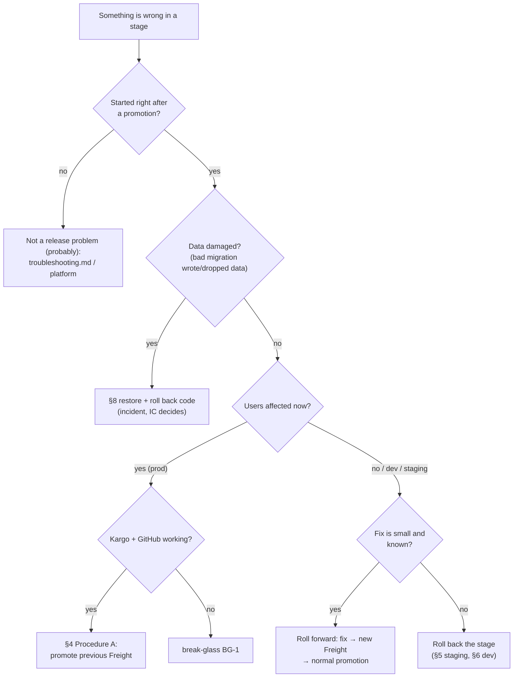

# Rollback

## 1. Principles
- **Rollback = promote the previous Freight** to the affected stage. It uses the same path as any
  promotion: rendered, reviewed (prod), synced, verified, audited.
- It rolls back **code and manifests/config** (the Freight's images *and* its `main` commit).
  It does **not** roll back the **database schema**. That's safe because migrations are expand/contract
  (`docs/handoffs/pantry-db.md`). If the *data* is damaged, see §8.
- **Mitigate first, investigate second.** If prod users are affected and the last promotion is the
  likely cause, roll back now and debug in staging afterwards.
- `git revert` / `kubectl rollout undo` are **not** rollback tools here. Argo CD or Kargo would undo them,
  or they'd leave Kargo's view wrong.

## 2. Decide: roll back, roll forward, or restore?



## 3. Find the rollback target

The target is normally **the Freight the stage ran before the bad promotion.**

| Where | How |
|---|---|
| Kargo UI | Stage → *Freight history*: the entry before the current one |
| git (always works) | `git log --format='%h %ad %s' --date=iso -5 origin/stage/prod`: each commit is "promote `<freight>` to prod"; the second line is your target |
| kubectl | `kubectl --context hub -n pantry describe stage prod` (freight history in status) |

**Check the target is safe to return to:**
```bash
# What the rollback will change = the reverse of the last promotion's diff.
git diff origin/stage/prod~1 origin/stage/prod --stat
git diff origin/stage/prod~1 origin/stage/prod -- infra/     # infra changes: read these carefully
```
- If the bad promotion changed **infra** (CNPG `Cluster`, ExternalSecrets, Namespaces), the rollback
  reverses that too. Usually that's fine. But don't undo a Key Vault key rename unless the old key still
  exists, and don't cut `instances` on a busy cluster without thought.
- If the bad promotion **included a migration**, the old code will run against the new schema. Under
  expand/contract that's supported. If the migration was a *contract* step (dropped something the old
  code reads), rolling back breaks the old code too: roll forward or restore (§8).

## 4. Procedure A: roll back prod (standard)

**Who:** on-call with `Pantry.ProdApprover` (PIM-activate it now). **Takes:** ~10–15 min.

1. **Declare:** in the team channel, *"Rolling back prod from `<current alias>` to `<target alias>`: `<symptom>`."*
   If users are affected, open an incident.
2. **Promote the target:**
   - UI: stage **prod** → *Promote* → pick the target Freight (it was verified and soaked before, so
     it's still offered).
   - CLI: `kargo promote --stage prod --freight <target-name>` ⚑
3. **PR:** `gh pr list -R pjvjay/pantry-gitops --base stage/prod` → `gh pr diff … <n>`. The diff should be
   the **exact reverse** of `git diff origin/stage/prod~1 origin/stage/prod`. Approve and merge.
   - *Incident exception:* normally a second person approves. During a declared incident the on-call may
     approve their own rollback PR (GitHub allows it, since the author is the Kargo App). Note it in the
     incident.
4. **Watch** as in [promotion.md §4.4](promotion.md#44-merge-then-watch). The pre-promotion backup runs
   here too (a bonus restore point). The migration Job finds nothing to do. Then the rollout.
5. **Confirm:** Promotion `Succeeded`, `pantry-smoke` passes, the symptom is gone, and the Applications
   show the rollback commit.
6. **Quarantine the bad Freight** (§7) and announce *"prod rolled back to `<target alias>`"*.

If step 3 or 4 can't complete (GitHub down, Kargo down, the PR review loop too slow for the impact), use
[break-glass BG-1](break-glass-and-dr.md#bg-1-emergency-prod-rollback-faster-than-a-pr).

## 5. Procedure B: roll back staging

**Who:** `Pantry.Promoter`. **Takes:** ~5 min.
1. Kargo UI → stage **staging** → *Promote* → the previous Freight (it's verified in dev, so it's offered).
   CLI: `kargo promote --stage staging --freight <target-name>` ⚑
2. Watch and confirm as in [promotion.md §3](promotion.md#3-promote-to-staging).
3. Quarantine the bad Freight (§7), so nobody promotes it to prod, whose soak clock started when it
   reached staging.

## 6. Procedure C: roll back dev

Dev **auto-promotes the newest Freight**. If you promote an older one, Kargo may promptly put the newest,
broken one back. So:
- **Preferred: roll forward.** Revert the offending change in the app repo (or in `main`). The new Freight
  auto-promotes. It's fast, and dev is the place for it.
- **If dev must be on an older Freight now:** PR `autoPromotionEnabled: false` for `dev` in
  `hub/kargo/project.yaml`, merge, then promote the older Freight to dev. **Revert the PR** once a fixed
  Freight exists.

## 7. Quarantine the bad Freight

Kargo has no "block" flag. Make it unmistakable instead:
- [`Pantry.Oncall`] Kargo UI → Freight → *Edit alias* → `bad-<incident-id>`. (CLI: `kargo update freight
  --old-alias <alias> --new-alias bad-<incident-id>` ⚑)
- Post it in the channel. Reviewers will see the alias in any PR for it.
- Newer Freight (the fix) supersedes it. Dev auto-promotion always picks the newest.

## 8. When data is damaged

Rolling back code doesn't repair data.
- **Prod:** stop writes if needed (roll back code first, so the bug stops writing), then follow
  [DR-2](break-glass-and-dr.md#dr-2-restore-prod-data-schema-or-data-corruption): point-in-time restore to
  *just before* the bad promotion. The pre-promotion backup (`Backup/pantry-pre-promotion`, taken at the
  start of every prod promotion) plus WAL makes that possible.
- **dev/staging:** restore from a `pg_dump`, or re-seed (the seed is idempotent). Those stages have no
  object-store backups.

## 9. Close out
- [ ] Stage healthy on the target Freight; verification passed; symptom gone.
- [ ] Bad Freight quarantined (§7).
- [ ] If dev auto-promotion was paused (§6), a follow-up to re-enable it exists.
- [ ] Incident record: timeline (Promotion names and times from the Kargo UI), cause, fix-forward owner.
- [ ] If this runbook was wrong or slow anywhere, PR a fix to it today.
